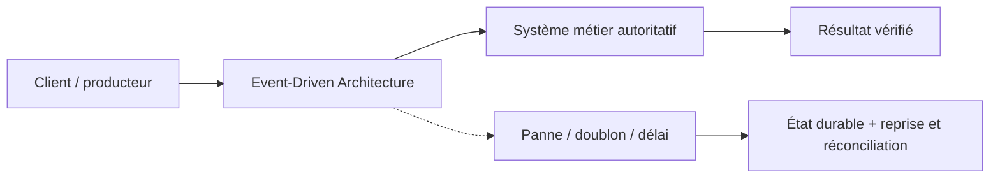
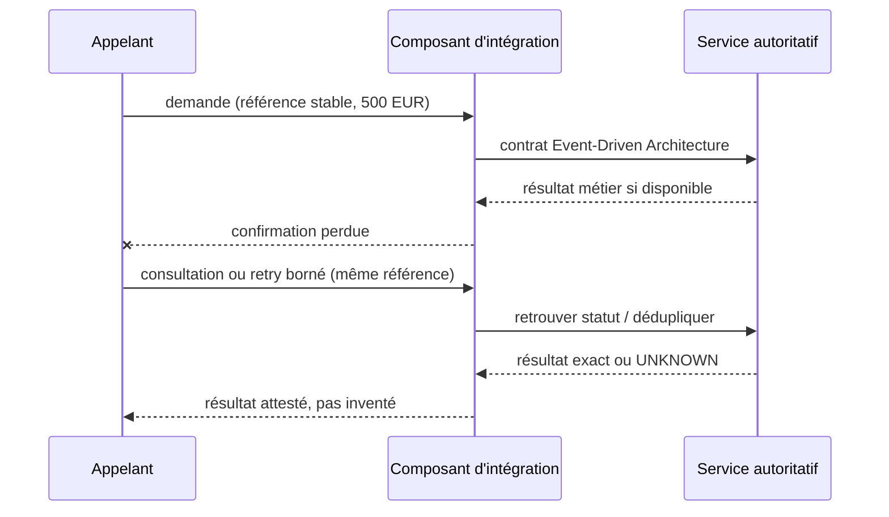

# Cours 87 — Event-Driven Architecture · Intégration bancaire

> Banque fictive · ordre SEPA de 500 EUR · exercice corrigé théorique, **non validé individuellement en session**.

## 1. Intention
Apprendre pourquoi choisir **Event-Driven Architecture** dans une architecture entre Java/Spring, API, IBM MQ, Kafka et les systèmes métier. Étudier contrats, frontières de responsabilité, incidents et preuve de non-régression.

## 2. Fil rouge bancaire et règles
Une demande SEPA de 500 EUR possède une **référence métier stable**, distincte du messageId, correlationId et traceId. Les producteurs, intermédiaires et consommateurs peuvent perdre des confirmations ou redélivrer une demande.

1. Décrire ce que prouve chaque accusé technique et ce qui établit un statut bancaire autoritatif.
2. Définir délais, rétention, version du contrat, sécurité, ownership et stratégie de replay.
3. Garantir par une preuve de test que deux messages de même référence ne créent pas deux effets financiers.
4. Ne jamais traduire automatiquement un timeout en rejet métier ni ACK broker en règlement.
5. Vérifier l'échéance métier avant toute reprise d'un ordre de paiement instantané.

## 3. Architecture de décision

## 4. Séquence de panne à expliquer en comité

## 5. Vérifications à réaliser
- Nominal : contrat correct, traitement autorisé et statut exact.
- Doublon concurrent : une seule exécution autoritative malgré redélivrance.
- Panne après écriture : état retrouvé sans double exécution.
- Contrat incompatible : erreur explicite, DLQ/quarantaine si appropriée.
- Sécurité : rejeter accès objet non autorisé, sans fuite d'identifiant ni de contenu.
- Exploitation : mesurer latence, backlog, échéance, retries, disponibilité et preuve de reprise.
- Arbitrage : comparer à un appel direct ou à une conception plus simple si les contraintes le permettent.

## 6. QCM corrigé
**Quelle approche est défendable pour utiliser Event-Driven Architecture ?**

- **A.** Retenir Event-Driven Architecture avec un contrat versionné, une clé métier stable et des tests de reprise.
- **B.** Supposer que Event-Driven Architecture garantit automatiquement l'exécution financière exactement une fois.
- **C.** Exécuter les reprises sans contrôle d'autorisation ni rapprochement.

**Corrigé : A.** Les garanties viennent du contrat, des invariants et des tests ; le mécanisme technique seul ne prouve pas la finalité du paiement.

## 7. Support technique détaillé — fiche existante
Les schémas, exemples de messages, compromis et scénarios d'échec suivants proviennent du référentiel déjà conservé dans le même dépôt.

**[Fiche source originale](https://github.com/zdmooc/enterprise-architecture-patterns-handbook/blob/main/01-integration-patterns/04-event-driven-architecture/README.md)**

#### Définition : un style architectural, pas un broker
Une **EDA** organise les applications autour de faits significatifs (« PaymentRequested », « FundsReserved », « PaymentSettled »). Un service réagit à un fait métier et produit à son tour une décision, un état ou un nouvel événement. **Pub/Sub** est l'un de ses mécanismes de distribution ; Kafka ou messagerie MQ sont des choix d'infrastructure et non la définition de l'EDA.

#### Exemple bancaire fictif : virement de 500 €
~~~mermaid
flowchart TD
  A["Demande de virement"] --> E1["PaymentRequested"]
  E1 --> V["Contrôles / risque"]
  V -->|autorisé| E2["PaymentAuthorized"]
  V -->|refusé| R["PaymentRejected"]
  E2 --> F["Gestion des fonds"]
  F --> E3["FundsReserved"]
  E3 --> P["Exécution bancaire"]
  P -->|confirmation autoritative| E4["PaymentSettled"]
  E4 --> N["Notification / Reporting"]
~~~

Ce flux est *logique*. Pour une opération critique, les décisions d'avancement peuvent être **orchestrées par une Saga**. On ne confond jamais événements « commandés », « acceptés » et « réglés ».

#### Deux modèles de communication
- **Notification d'événement** : renseigne sur un fait accompli ; abonnés autonomes.
- **Event-carried state transfer** : transporte certaines données permettant une projection autonome ; données minimales, vie privée et fraîcheur à cadrer.
Ne pas faire dépendre une décision financière irréversible de données reçues tardivement ou dont l'autorité est incertaine.

#### Event contract (illustratif)
~~~json
{
  "eventId":"evt-002",
  "type":"PaymentAuthorized",
  "schemaVersion":1,
  "aggregateId":"VIR-001",
  "occurredAt":"2026-10-18T10:00:00Z",
  "correlationId":"corr-01",
  "causationId":"evt-001"
}
~~~
Les champs correlationId / causationId permettent le suivi de chaînes d'événements. Ne pas inscrire secrets, PAN, IBAN complets ou autres données sensibles inutilement.

#### Garanties à concevoir
- **Publication atomique avec changement d'état local** : Outbox ou alternative rigoureusement justifiée.
- **At-least-once et redélivrance** : consommateurs idempotents ; eventId stable.
- **Ordre** : les événements peuvent arriver hors ordre entre partitions et producteurs ; numéro de version/sequence par agrégat, contrôle des transitions.
- **Convergence** : projections éventuellement cohérentes ; indiquer aux consommateurs quelle source fait autorité.
- **Évolution** : schémas gouvernés, compatibilité et métadonnées.
- **Supervision** : DLQ/parking, métriques de délais bout en bout, lag, taux de duplication et événements sans propriétaire.

#### Scénarios de panne et décisions
| Incident | Mauvaise réaction | Réaction correcte |
|---|---|---|
| Notification hors service | Bloquer le règlement | Rejouer notification indépendamment |
| Event PaymentSettled en double | Double écriture comptable | Déduplication par transition métier |
| Événements hors ordre | Basculer SETTLED vers PROCESSING | Refuser transition arrière |
| Publication perdue | Considérer le SI convergent | Outbox + rapprochement |
| Contrôle antifraude en échec | Avancer automatiquement | Décision explicite selon politique |

#### Quand ne pas choisir une EDA
Un CRUD simple à faible couplage, une décision exigeant une cohérence strictement synchrone, ou un workflow à états très réglementés mais sans mécanisme de corrélation/reprise. La multiplication de microservices événementiels peut augmenter les coûts de compréhension et d'exploitation.

#### Gouvernance d'architecture
Identifier propriétaire de chaque événement, matrice producteur/consommateur, catalogue, fréquence/volumétrie, version, classification des données, SLO de propagation et tests de contract. Documenter les transitions interdites.

#### Questions entretien
**EDA vs Pub/Sub ?** EDA = organisation des réactions autour de faits ; Pub/Sub = diffusion. **EDA = Event Sourcing ?** Non : Event Sourcing reconstruit l'état depuis le journal des événements ; ce n'est pas une exigence EDA. **Le broker fait-il respecter le cycle de vie financier ?** Non : la logique métier et la réconciliation appartiennent à l'application et au système autoritatif.

Liens : 03 Pub/Sub, 05 Event Streaming, 08 Saga, 10 Idempotency.

---

#### Illustrations complémentaires — une architecture réactive aux faits métier

#### La chaîne du virement et les branches indépendantes
~~~mermaid
flowchart TD
    A["PaymentRequested"] --> B["Contrôles obligatoires"]
    B -->|"Validé"| C["PaymentAuthorized"]
    B -->|"Refusé"| R["PaymentRejected"]
    C --> D["Gestion des fonds"]
    D --> E["FundsReserved"]
    E --> F["Soumission et confirmation de règlement"]
    F --> G["PaymentSettled"]
    G --> N["Notification"]
    G --> S["Supervision"]
    G --> L["Projection analytique"]
~~~
Chaque bloc réagit à un **fait publié** selon un contrat. En pratique, la Saga peut orchestrer les commandes critiques ; les branches de notification restent indépendantes.

#### Différence d'intention : événement et commande
~~~mermaid
flowchart LR
    O["Saga"] -->|"Commande : ReserveFunds"| F["Service Fonds"]
    F -->|"Fait : FundsReserved"| T["Bus événementiel"]
    T --> S["Saga : étape suivante"]
    T --> A["Audit métier"]
~~~
Un événement ne doit pas être traité comme une commande déguisée : le producteur annonce ce qui **a eu lieu** ; le consommateur reste responsable de sa réaction.

#### Point de vigilance
Si \`PaymentSettled\` arrive deux fois, le service de notification évite deux envois non souhaités par déduplication ; si \`PaymentRejected\` arrive **après** \`PaymentSettled\`, la machine à états refuse une régression sans preuve de correction.

[Retour à l'index](README.md)
