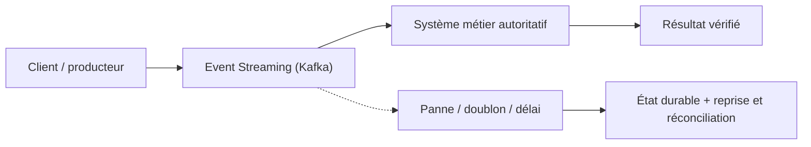
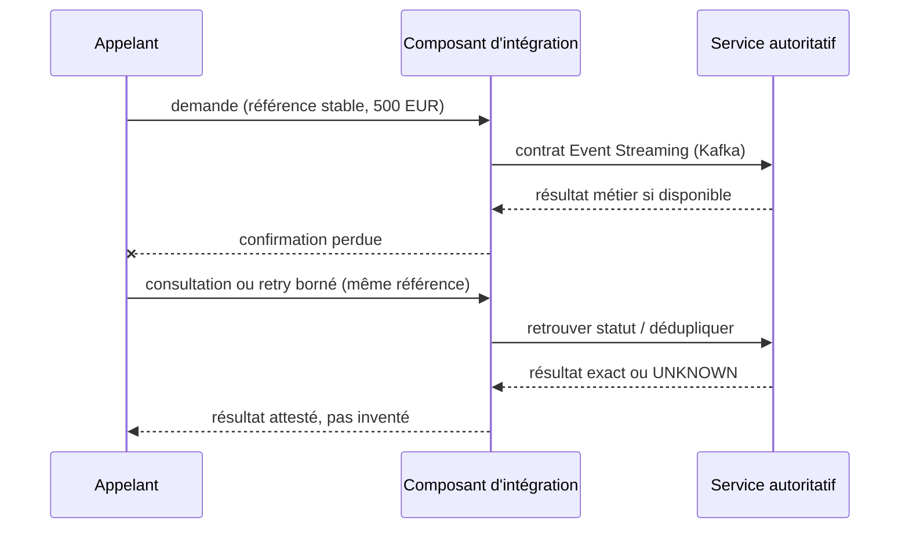

# Cours 88 — Event Streaming (Kafka) · Intégration bancaire

> Banque fictive · ordre SEPA de 500 EUR · exercice corrigé théorique, **non validé individuellement en session**.

## 1. Intention
Apprendre pourquoi choisir **Event Streaming (Kafka)** dans une architecture entre Java/Spring, API, IBM MQ, Kafka et les systèmes métier. Étudier contrats, frontières de responsabilité, incidents et preuve de non-régression.

## 2. Fil rouge bancaire et règles
Une demande SEPA de 500 EUR possède une **référence métier stable**, distincte du messageId, correlationId et traceId. Les producteurs, intermédiaires et consommateurs peuvent perdre des confirmations ou redélivrer une demande.

1. Décrire ce que prouve chaque accusé technique et ce qui établit un statut bancaire autoritatif.
2. Définir délais, rétention, version du contrat, sécurité, ownership et stratégie de replay.
3. Garantir par une preuve de test que deux messages de même référence ne créent pas deux effets financiers.
4. Ne jamais traduire automatiquement un timeout en rejet métier ni ACK broker en règlement.
5. Vérifier l'échéance métier avant toute reprise d'un ordre de paiement instantané.

## 3. Architecture de décision

## 4. Séquence de panne à expliquer en comité

## 5. Vérifications à réaliser
- Nominal : contrat correct, traitement autorisé et statut exact.
- Doublon concurrent : une seule exécution autoritative malgré redélivrance.
- Panne après écriture : état retrouvé sans double exécution.
- Contrat incompatible : erreur explicite, DLQ/quarantaine si appropriée.
- Sécurité : rejeter accès objet non autorisé, sans fuite d'identifiant ni de contenu.
- Exploitation : mesurer latence, backlog, échéance, retries, disponibilité et preuve de reprise.
- Arbitrage : comparer à un appel direct ou à une conception plus simple si les contraintes le permettent.

## 6. QCM corrigé
**Quelle approche est défendable pour utiliser Event Streaming (Kafka) ?**

- **A.** Supposer que Event Streaming (Kafka) garantit automatiquement l'exécution financière exactement une fois.
- **B.** Retenir Event Streaming (Kafka) avec un contrat versionné, une clé métier stable et des tests de reprise.
- **C.** Exécuter les reprises sans contrôle d'autorisation ni rapprochement.

**Corrigé : B.** Les garanties viennent du contrat, des invariants et des tests ; le mécanisme technique seul ne prouve pas la finalité du paiement.

## 7. Support technique détaillé — fiche existante
Les schémas, exemples de messages, compromis et scénarios d'échec suivants proviennent du référentiel déjà conservé dans le même dépôt.

**[Fiche source originale](https://github.com/zdmooc/enterprise-architecture-patterns-handbook/blob/main/01-integration-patterns/05-event-streaming/README.md)**

#### Problème
Analyser des volumes importants de transactions en continu, les redistribuer à plusieurs applications et **rejouer** une période disponible dans la rétention : supervision, fraude, analytics et reconstruction de projections.

#### Kafka : modèle logique
~~~mermaid
flowchart LR
  P1["Paiements carte"] --> T["Topic payments.events.v1 P0 | P1 | P2"]
  P2["Virements"] --> T
  T --> F["Consumer group: fraude"]
  T --> R["Consumer group: reporting"]
  T --> O["Consumer group: observabilité"]
~~~

- **Topic** : journal logique ; **partition** : journal ordonné de records ; **offset** : position dans une partition.
- **Producer** : écrit ; **Consumer Group** : instances se répartissant les partitions ; un autre groupe reçoit le même flux logiquement.
- **Clé d'agrégat** : choisir paymentId pour garder la succession de statuts d'un paiement dans une même partition. Pas d'ordre global garanti entre partitions.
- **Rétention** : période/volume de conservation configurés, indépendante du fait d'avoir lu ; après expiration, replay impossible depuis le topic.
- **Lag** : retard d'un groupe sur les partitions ; doit être surveillé par service et adapté aux SLO.
- **Compaction** : option distincte de la rétention temporelle ; conserve typiquement la dernière valeur par clé suivant règles et configuration, ne remplace pas un historique financier complet.

#### Détection d'anomalies : scénario
Une série de cinq transactions en 20 secondes est regroupée dans une fenêtre événementielle de 30 secondes pour détecter un comportement suspect. La fraude présumée appelle un contrôle et non une déclaration automatique de fraude prouvée. Si l'autorisation carte doit être bloquée **avant** le paiement, le chemin de décision synchrone/temps réel doit disposer d'un SLO et de contrôles dédiés : le reporting post-règlement ne suffit pas.

#### Garanties de livraison
L'idempotence du producteur Kafka, ses transactions et l'exactly-once processing **dans le périmètre Kafka supporté** ne protègent pas automatiquement un système externe (DB, cœur bancaire, PSP). Prévoir déduplication métier à la destination. Si des transactions DB et Kafka doivent être coordonnées, étudier Outbox/CDC ; vérifier rejouabilité des consommateurs.

#### Gouvernance et sécurité
- ACL des topics, chiffrement TLS, SASL/mTLS selon installation ; schémas enregistrés et versionnés.
- Separer topics de commande critique et événements dérivés ; classification des données et minimisation.
- Fixer partitions selon débit, parallélisme, coût et ordre par clé ; la hausse du nombre de partitions peut modifier l'affectation d'une clé.
- Configurer réplication, paramètres de durabilité/ACK, disponibilité, stockage et rétention ; tester perte de broker.
- Contrôler producer errors, under-replicated partitions, disk, ISR, consumer lag, rebalance, délais end-to-end.

#### Kafka vs messagerie MQ
| Critère | Kafka | messagerie MQ |
|---|---|---|
| Modèle mis en valeur | Journal d'événements partitionné, plusieurs groupes | Files de travail, commandes et request/reply |
| Après consommation | Conserve selon rétention | Message généralement retiré après commit GET |
| Replay | Offsets sur données encore conservées | Redélivrance/reprise de messages non consommés ou républiés |
| Ordre | Dans une partition | Dépend des files, priorité, consommateurs et configuration |
| Exactly once externe | Non automatique | Non automatique |

Les deux savent transporter des messages et diffuser de l'information ; le choix dépend des exigences, pas d'un slogan.

#### Pannes à tester
1. Perte de la connexion broker pendant publication.
2. Crash consommateur entre effet dans DB et commit d'offset.
3. Rebalance avec traitement en vol.
4. Désérialisation de schéma incompatible (parking, alerte, correction).
5. Lag dépassant la rétention et reconstruction par source autoritative.

#### Questions / checklist
Pourquoi partitionner par paymentId ? Préserver l'ordre par paiement. Que signifie le lag ? Un retard de lecture et pas une preuve d'échec financier. Que faire si un topic n'a plus l'historique nécessaire ? Reconstituer depuis la source autoritative / snapshot validé.

Sources : [Kafka — partitionnement](https://kafka.apache.org/40/design/protocol/), [Kafka — offset tracking](https://kafka.apache.org/40/implementation/distribution/).

---

#### Illustrations complémentaires — partitions, offsets et analyse de flux

#### Le topic conserve les événements
~~~mermaid
flowchart TB
    P["Producteur paiements"] --> T["Topic : payments.status.v1"]
    T --> K0["Partition 0 : offset 100 → 101 → 102"]
    T --> K1["Partition 1 : offset 77 → 78 → 79"]
    K0 --> F["Groupe détection fraude"]
    K1 --> F
    K0 --> R["Groupe reporting"]
    K1 --> R
    F --> LF["Offset mémorisé par groupe fraude"]
    R --> LR["Offset mémorisé par groupe reporting"]
~~~
Les offsets sont **par partition**, la lecture peut être à des vitesses différentes et le même flux reste disponible tant qu'il est retenu. Le compteur global 100,101,... d'une partition n'est pas un ordre entre partitions.

#### Exemple de fenêtre d'analyse : 5 transactions / 20 secondes
| Heure | Ville fictive de l'opération | Montant |
|---|---|---:|
| 10:00:01 | Ville A | 50 € |
| 10:00:04 | Ville A | 75 € |
| 10:00:08 | Ville A | 100 € |
| 10:00:13 | Ville B | 800 € |
| 10:00:20 | Ville B | 1 200 € |

**Fenêtre de 30 secondes :** cinq mouvements, **2 225 €**, deux lieux. Le moteur peut créer une **alerte à vérifier**, et non conclure automatiquement à une fraude.

#### Détection en continu, résultat explicable
~~~mermaid
flowchart LR
    K["Journal Kafka : transactions"] --> W["Fenêtre temporelle 30 s"]
    W --> AGG["Agrégat : 5 opérations / 2 lieux / 2 225 EUR"]
    AGG --> RULE{"Seuils de suspicion atteints ?"}
    RULE -->|Oui| ALERT["Alerte à instruire"]
    RULE -->|Non| PASS["Flux normal"]
~~~
**Pour interdire une transaction avant autorisation**, une chaîne antifraude en temps réel avec un budget de latence strict doit être intégrée au parcours critique. Le streaming post-règlement ne suffit pas.

[Retour à l'index](README.md)
