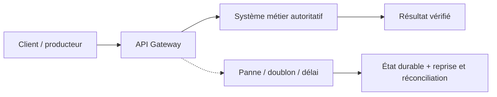
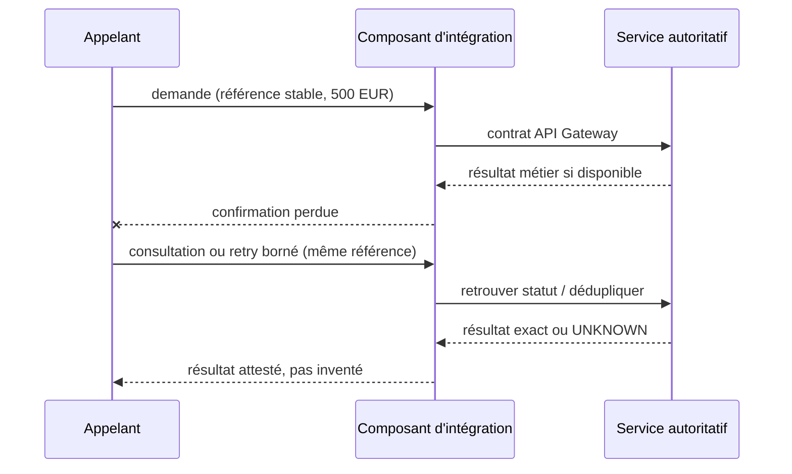

# Cours 89 — API Gateway · Intégration bancaire

> Banque fictive · ordre SEPA de 500 EUR · exercice corrigé théorique, **non validé individuellement en session**.

## 1. Intention
Apprendre pourquoi choisir **API Gateway** dans une architecture entre Java/Spring, API, IBM MQ, Kafka et les systèmes métier. Étudier contrats, frontières de responsabilité, incidents et preuve de non-régression.

## 2. Fil rouge bancaire et règles
Une demande SEPA de 500 EUR possède une **référence métier stable**, distincte du messageId, correlationId et traceId. Les producteurs, intermédiaires et consommateurs peuvent perdre des confirmations ou redélivrer une demande.

1. Décrire ce que prouve chaque accusé technique et ce qui établit un statut bancaire autoritatif.
2. Définir délais, rétention, version du contrat, sécurité, ownership et stratégie de replay.
3. Garantir par une preuve de test que deux messages de même référence ne créent pas deux effets financiers.
4. Ne jamais traduire automatiquement un timeout en rejet métier ni ACK broker en règlement.
5. Vérifier l'échéance métier avant toute reprise d'un ordre de paiement instantané.

## 3. Architecture de décision

## 4. Séquence de panne à expliquer en comité

## 5. Vérifications à réaliser
- Nominal : contrat correct, traitement autorisé et statut exact.
- Doublon concurrent : une seule exécution autoritative malgré redélivrance.
- Panne après écriture : état retrouvé sans double exécution.
- Contrat incompatible : erreur explicite, DLQ/quarantaine si appropriée.
- Sécurité : rejeter accès objet non autorisé, sans fuite d'identifiant ni de contenu.
- Exploitation : mesurer latence, backlog, échéance, retries, disponibilité et preuve de reprise.
- Arbitrage : comparer à un appel direct ou à une conception plus simple si les contraintes le permettent.

## 6. QCM corrigé
**Quelle approche est défendable pour utiliser API Gateway ?**

- **A.** Supposer que API Gateway garantit automatiquement l'exécution financière exactement une fois.
- **B.** Exécuter les reprises sans contrôle d'autorisation ni rapprochement.
- **C.** Retenir API Gateway avec un contrat versionné, une clé métier stable et des tests de reprise.

**Corrigé : C.** Les garanties viennent du contrat, des invariants et des tests ; le mécanisme technique seul ne prouve pas la finalité du paiement.

## 7. Support technique détaillé — fiche existante
Les schémas, exemples de messages, compromis et scénarios d'échec suivants proviennent du référentiel déjà conservé dans le même dépôt.

**[Fiche source originale](https://github.com/zdmooc/enterprise-architecture-patterns-handbook/blob/main/01-integration-patterns/06-api-gateway/README.md)**

#### Intention
Exposer des APIs de paiement à des consommateurs mobiles, web et partenaires avec un point de contrôle central. **Gateway = chemin de données/runtime** ; **API Management = gouvernance et cycle de vie** (catalogue, publication, contrats, abonnements, versions, analytics, portail développeurs). Une suite API Management peut intégrer une ou plusieurs Gateways.

#### Exemple
~~~mermaid
flowchart TB
  C["Application mobile / partenaire"]
  IAM["IdP : OAuth 2.0 / OIDC"]
  G["API Gateway : TLS, JWT, quota, routage"]
  R["OpenShift Route / Ingress"]
  S["Payment API Java"]
  B["Moteur d'autorisation métier"]
  C -->|HTTPS Bearer token| G
  C <-.-> IAM
  G -->|Token validé| R
  R --> S
  S --> B
  G -.->|JWKS / introspection selon contrat| IAM
~~~

#### Trois contrôles distincts
1. **Authentification** : identité vérifiée dans un parcours adapté (OIDC pour couche identité) ; OAuth 2.0 vise d'abord l'autorisation déléguée.
2. **Autorisation d'accès API** : scope, audience, destinataire, contexte, limites.
3. **Autorisation métier** : droits sur le **compte et le paiement précis**, plafond, bénéficiaire, règles de conformité et validation du paiement. Un JWT valide ne suffit jamais pour déclencher 500 €.

#### Contrat exemple (fictif)
~~~http
POST /api/v1/payments
Authorization: Bearer TOKEN
Idempotency-Key: PAY-001
X-Correlation-ID: corr-01
Content-Type: application/json
~~~
Décisions à contracter : codes 201/202/4xx/5xx, statut métier, suivi, règles de réitération, schéma d'erreurs, versionnement, délai d'acceptation et délai métier d'exécution. Ne pas mettre le token ni des identifiants personnels dans les logs.

#### Contrôles sécurité
- TLS en entrée ; TLS vers backend, éventuellement mTLS ; validation du certificat et renouvellement.
- JWT : signature, algorithme autorisé, iss, aud, exp, nbf, scope et rotation JWKS ; tokens opaques : introspection selon contrat.
- Rate limiting / quotas et protection contre brute force ; éviter un point unique de saturation.
- Authorization Object Level dans le service : le détenteur du token ne peut pas lire n'importe quel paymentId.
- Schémas, taille de payload, parsing, rejet de propriétés non autorisées ; revue OWASP API Top 10.
- Secrets gérés, séparation des environnements, journalisation non sensible, politiques de conservation et pistes d'audit.

#### Gateway vs OpenShift Route
La Route expose et route le trafic vers le Service, mais ne constitue pas, à elle seule, la gouvernance complète d'API. Pour OpenShift, documenter la topologie (edge / reencrypt / passthrough), le termination TLS, l'identité vue par le backend et la chaîne de confiance.

#### Performance et résilience
HA multi-réplicas, zones de panne, timeouts par saut, quotas pour consommateurs, métriques p95/p99, disponibilité et certificats. Un *fallback* d'une requête d'exécution ne doit jamais inventer « paiement rejeté/réussi » si statut inconnu.

#### Pannes / réponses
| Cas | Comportement |
|---|---|
| Token expiré | 401 ; renouvellement géré par le client |
| Scope insuffisant | 403 |
| Quota dépassé | 429 ; Retry-After si applicable |
| Backend lent | 504 / erreur contractuelle ; statut financier à vérifier |
| Clé idempotente répétée | Acheminer vers même intention métier |

#### API Management : livrables d'architecture
Catalogue, contrats OpenAPI, exposition/consommateurs, politiques, versions, dépréciations, portail développeur, tests de sécurité, observabilité et ownership. L'outillage peut être une suite intégrée d'API Management, une passerelle autonome ou un service managé. **Aucun choix de fournisseur réel n'est revendiqué.**

#### Questions d'entretien / critères
- OIDC vs OAuth2 vs JWT ? Couche d'identité / cadre d'autorisation / format de jeton.
- 401 vs 403 vs 429 ? Non authentifié / non autorisé / quota.
- API Gateway remplace-t-elle les contrôles métier ? **Non**.
- Quels contrôles protègent un POST de paiement contre répétition ? Clé d'idempotence et unicité dans le système métier, pas seulement quota Gateway.

Sources : [OpenID Connect Core](https://openid.net/specs/openid-connect-core-1_0.html), [OWASP API Security Top 10](https://api-security.owasp.org/editions/2023/en/0x11-t10/).

---

#### Illustrations complémentaires — sécurité et gouvernance des API

#### Identité, accès technique et décision métier
~~~mermaid
flowchart TB
    U["Canal bancaire"] --> IDP["Fournisseur d'identité : OAuth2 / OIDC"]
    IDP --> U
    U -->|"HTTPS + token"| G["API Gateway"]
    G -->|"Valider JWT/audience/scopes"| R["Route OpenShift"]
    R --> A["Service Paiements Java"]
    A --> Z{"Client autorisé sur ce compte et ce bénéficiaire ?"}
    Z -->|Oui| P["Contrôles de paiement / SCA applicable"]
    Z -->|Non| DENY["Refus sans effet financier"]
    P --> CORE["Core bancaire"]
~~~
**Identification** ≠ **droit d'appeler une API** ≠ **autorisation d'effectuer ce virement précis**. La Gateway ne valide pas le solde ou le consentement métier à elle seule.

#### Management versus Gateway
~~~mermaid
flowchart LR
    M["API Management : catalogue, version, portail, politiques"] -->|"Déploie la politique"| G["API Gateway runtime"]
    C["Consommateurs autorisés"] -->|"Requêtes"| G
    G -->|"Routage + contrôle"| B["Services API"]
    G -->|"Métriques"| M
~~~
Les technologies peuvent être intégrées dans un même produit, mais restent des **responsabilités différentes**.

#### Réponses à distinguer
\`401\` identité invalide, \`403\` droit refusé, \`429\` quota dépassé, \`504\` service amont trop lent : **aucune de ces réponses ne démontre que le paiement lui-même a été exécuté ou rejeté**.

[Retour à l'index](README.md)
