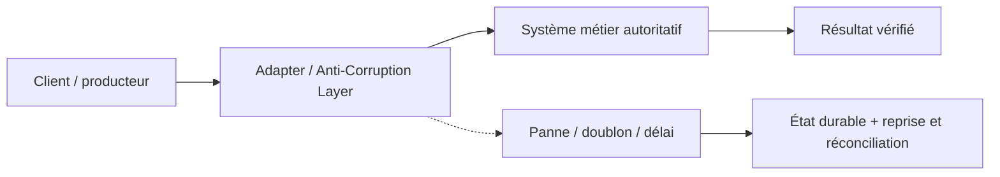
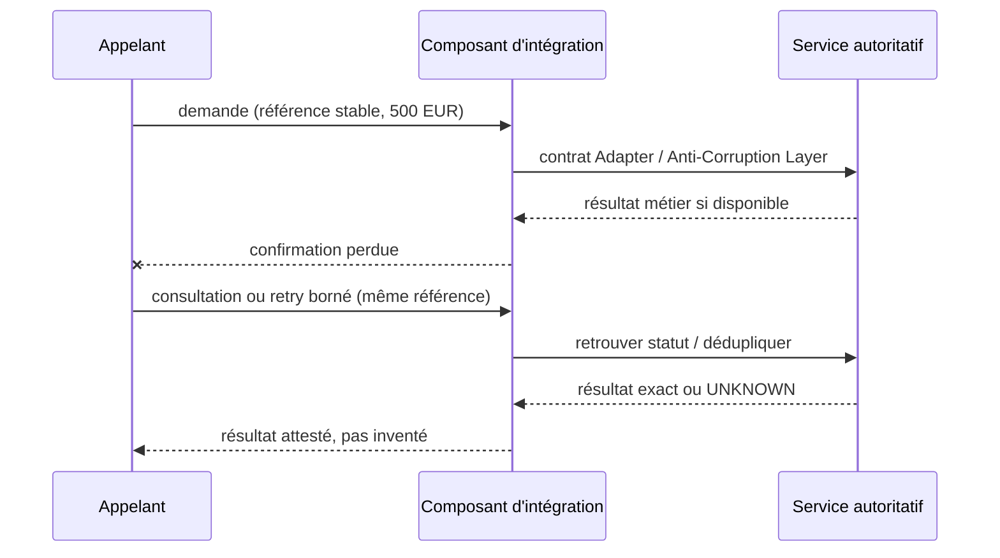

# Cours 90 — Adapter / Anti-Corruption Layer · Intégration bancaire

> Banque fictive · ordre SEPA de 500 EUR · exercice corrigé théorique, **non validé individuellement en session**.

## 1. Intention
Apprendre pourquoi choisir **Adapter / Anti-Corruption Layer** dans une architecture entre Java/Spring, API, IBM MQ, Kafka et les systèmes métier. Étudier contrats, frontières de responsabilité, incidents et preuve de non-régression.

## 2. Fil rouge bancaire et règles
Une demande SEPA de 500 EUR possède une **référence métier stable**, distincte du messageId, correlationId et traceId. Les producteurs, intermédiaires et consommateurs peuvent perdre des confirmations ou redélivrer une demande.

1. Décrire ce que prouve chaque accusé technique et ce qui établit un statut bancaire autoritatif.
2. Définir délais, rétention, version du contrat, sécurité, ownership et stratégie de replay.
3. Garantir par une preuve de test que deux messages de même référence ne créent pas deux effets financiers.
4. Ne jamais traduire automatiquement un timeout en rejet métier ni ACK broker en règlement.
5. Vérifier l'échéance métier avant toute reprise d'un ordre de paiement instantané.

## 3. Architecture de décision

## 4. Séquence de panne à expliquer en comité

## 5. Vérifications à réaliser
- Nominal : contrat correct, traitement autorisé et statut exact.
- Doublon concurrent : une seule exécution autoritative malgré redélivrance.
- Panne après écriture : état retrouvé sans double exécution.
- Contrat incompatible : erreur explicite, DLQ/quarantaine si appropriée.
- Sécurité : rejeter accès objet non autorisé, sans fuite d'identifiant ni de contenu.
- Exploitation : mesurer latence, backlog, échéance, retries, disponibilité et preuve de reprise.
- Arbitrage : comparer à un appel direct ou à une conception plus simple si les contraintes le permettent.

## 6. QCM corrigé
**Quelle approche est défendable pour utiliser Adapter / Anti-Corruption Layer ?**

- **A.** Retenir Adapter / Anti-Corruption Layer avec un contrat versionné, une clé métier stable et des tests de reprise.
- **B.** Supposer que Adapter / Anti-Corruption Layer garantit automatiquement l'exécution financière exactement une fois.
- **C.** Exécuter les reprises sans contrôle d'autorisation ni rapprochement.

**Corrigé : A.** Les garanties viennent du contrat, des invariants et des tests ; le mécanisme technique seul ne prouve pas la finalité du paiement.

## 7. Support technique détaillé — fiche existante
Les schémas, exemples de messages, compromis et scénarios d'échec suivants proviennent du référentiel déjà conservé dans le même dépôt.

**[Fiche source originale](https://github.com/zdmooc/enterprise-architecture-patterns-handbook/blob/main/01-integration-patterns/07-anti-corruption-layer/README.md)**

#### Problème
Un nouveau service Java/OpenShift doit coopérer avec un système historique CICS/COBOL, messagerie MQ ou Java/JEE. Les formats et **significations métier** ne sont pas identiques. Une conversion technique ne suffit pas : les codes « A01 = ordre accepté » et « règlement confirmé » ne décrivent pas le même état.

#### Différence fondamentale
- **Adapter** : traduit interfaces techniques (REST/JSON ↔ MQ, SOAP, fichier, COBOL copybook), codecs, unités, formats.
- **Anti-Corruption Layer** : protège *le modèle de domaine* du système moderne en traduisant aussi statuts, invariants et conventions du legacy ; peut encapsuler un ou plusieurs adapters. Concept DDD.
- **API Gateway** : protège/routage les entrées ; ne remplace pas la traduction sémantique de domaine.

#### Conception fictive
~~~mermaid
flowchart TB
  J["Service Java : ExecutePayment"]
  P["Port métier PaymentExecutionPort"]
  ACL["ACL : PaymentExecutionTranslator"]
  A["MQ Adapter : sérialisation, corrélation"]
  Q["messagerie MQ REQUEST/RESPONSE"]
  C["COBOL / CICS legacy"]
  J --> P --> ACL --> A --> Q --> C
  C -.-> Q
  Q -.-> A
  A -.-> ACL
  ACL -.-> J
~~~

~~~text
Modèle Java : {paymentId:"VIR-001", amountMinor:50000, currency:"EUR"}
Modèle legacy fictif : REF=VIR-001 ; MONT_CENT=0000050000 ; DEVISE=EUR
Code retour A01 = ACCEPTED_FOR_PROCESSING ; E90 = REJECTED
~~~
Ce sont **des conventions fictives**, non attribuables à un établissement, un prestataire ou un logiciel réel.

#### Responsabilités du composant
1. Normaliser identifiants, unités monétaires, fuseaux, caractères, champs obligatoires.
2. Expliquer la correspondance des **états métier** ; jamais transformer ACCEPTED en SETTLED.
3. Centraliser anti-corruption des règles externes sans recopier le moteur métier dans l'ACL.
4. Traduire erreurs, codes, timeouts et cas « outcome unknown ».
5. Appliquer idempotency-key métier, correlation-id et versions de contrat sans inventer d'effet de livraison.
6. Journaliser transformations et décisions, sans exposer de données bancaires sensibles.

#### Exemple de matrice de traduction
| Legacy fictif | API moderne | Précaution |
|---|---|---|
| A01 | ACCEPTED | Pas un règlement |
| E90 | REJECTED | Motif normalisé |
| Pas de réponse | UNKNOWN / TO_RECONCILE | Ne pas créer un nouveau paiement |
| S00 | SETTLED (après preuve) | Résultat autoritatif à conserver |

#### Migration vers OpenShift
Strangler Fig : déployer une façade et de nouveaux services autour de l'existant ; migrer progressivement par capacités, jeux d'APIs, consommateurs et contrats stables. Décider si l'ACL vit en bibliothèque interne, microservice autonome ou composant d'intégration. Plus elle est centralisée, plus elle peut devenir un point de contention : haute disponibilité et ownership obligatoires.

#### Modes de panne
- Format incompatible : mettre en quarantaine avec motif sans exécution.
- Legacy ne répond pas : statut indéterminé + interrogation/réconciliation.
- Réponse hors ordre : matcher la même référence, valider transition.
- Nouvelle version du copybook : contract tests entre versions ; rollback contrôlé.
- Arrêt de l'ACL : messages durables + circuit breaker des appelants + plan de reprise.

#### Critères de décision
ACL recommandée si modèles métier indépendants, remplacement progressif, formats anciens ou risque élevé de pollution sémantique. Inutile si deux services partagent un contrat stable identique et pas de traduction de domaine.

#### Entretien
**Q : pourquoi ne pas faire connaître les codes COBOL aux microservices ?** R : cela crée un couplage fort et reporte la complexité de migration partout. **Q : Adapter = ACL ?** Non, l'ACL porte la traduction sémantique et la protection du modèle.

Sources : Référence conceptuelle : Anti-Corruption Layer (DDD), Eric Evans, *Domain-Driven Design* (référence conceptuelle).

---

#### Illustrations complémentaires — modèle moderne et système historique

#### Conversion technique puis protection sémantique
~~~mermaid
flowchart TB
    A["Java : {paymentId: VIR-001, amountMinor: 50000, currency: EUR}"]
    A --> B["Anti-Corruption Layer : invariant et statut métier"]
    B --> C["Adapter : JSON vers format historique"]
    C --> D["CORE : REF=VIR-001 ; MONT-CENT=50000 ; DEVISE=EUR"]
    D --> E["Réponse fictive A01 : reçu pour traitement"]
    E --> B
    B --> F["Statut interne ACCEPTED_FOR_PROCESSING"]
    B -.->|Interdit| X["Ne pas annoncer SETTLED sans preuve"]
~~~
La traduction protège le **sens** des états. Le code \`A01\` est **inventé pour la démonstration** ; il ne vient d'aucun système réel.

#### Modernisation progressive (Strangler Fig)
~~~mermaid
flowchart LR
    C["Canaux"] --> F["Façade stable / ACL"]
    F --> H["Traitement historique conservé"]
    F --> N["Capacité Java modernisée sur OpenShift"]
    N --> B["Core bancaire non remplacé"]
~~~
Commencer par conserver les fonctions existantes, extraire une capacité contrôlée, mesurer, puis retirer l'ancienne capacité **uniquement après validation**.

#### Variantes d'adaptation
- **REST → SOAP** : changement de protocole, validation du contrat XML.
- **REST → queue MQ** : transport asynchrone, corrélation et statuts.
- **Java → format fixe de type COBOL** : conversion centimes/unités/caractères.
- **Ancien code « reçu » → métier « accepté pour traitement »** : vraie responsabilité ACL, pas simple sérialisation.

[Retour à l'index](README.md)
