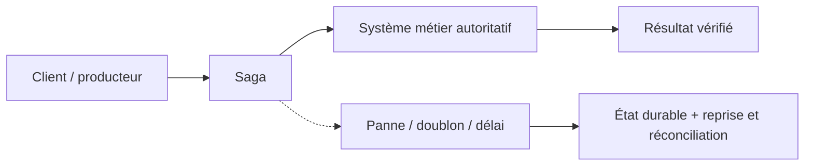
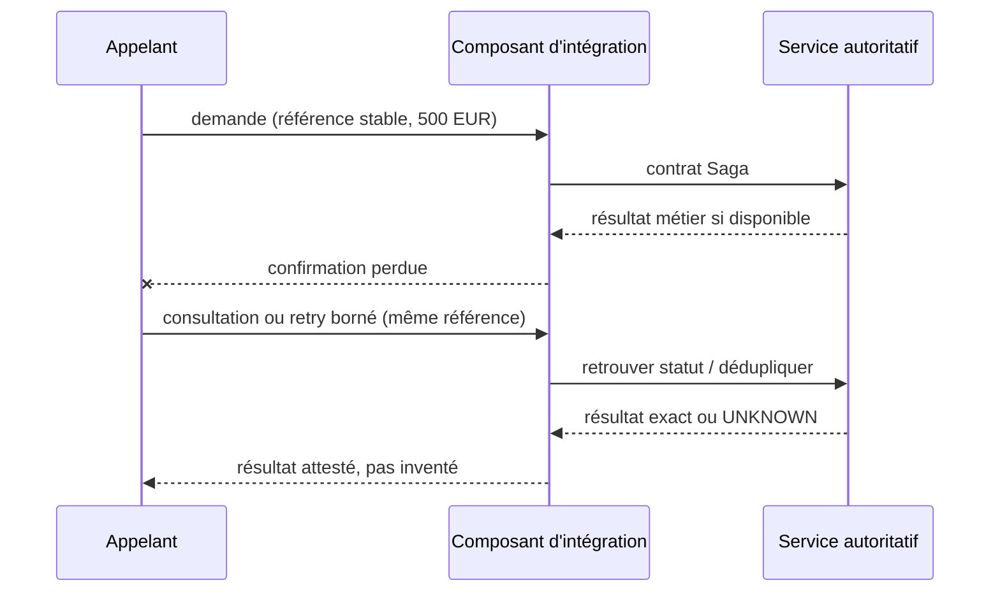

# Cours 91 — Saga · Intégration bancaire

> Banque fictive · ordre SEPA de 500 EUR · exercice corrigé théorique, **non validé individuellement en session**.

## 1. Intention
Apprendre pourquoi choisir **Saga** dans une architecture entre Java/Spring, API, IBM MQ, Kafka et les systèmes métier. Étudier contrats, frontières de responsabilité, incidents et preuve de non-régression.

## 2. Fil rouge bancaire et règles
Une demande SEPA de 500 EUR possède une **référence métier stable**, distincte du messageId, correlationId et traceId. Les producteurs, intermédiaires et consommateurs peuvent perdre des confirmations ou redélivrer une demande.

1. Décrire ce que prouve chaque accusé technique et ce qui établit un statut bancaire autoritatif.
2. Définir délais, rétention, version du contrat, sécurité, ownership et stratégie de replay.
3. Garantir par une preuve de test que deux messages de même référence ne créent pas deux effets financiers.
4. Ne jamais traduire automatiquement un timeout en rejet métier ni ACK broker en règlement.
5. Vérifier l'échéance métier avant toute reprise d'un ordre de paiement instantané.

## 3. Architecture de décision

## 4. Séquence de panne à expliquer en comité

## 5. Vérifications à réaliser
- Nominal : contrat correct, traitement autorisé et statut exact.
- Doublon concurrent : une seule exécution autoritative malgré redélivrance.
- Panne après écriture : état retrouvé sans double exécution.
- Contrat incompatible : erreur explicite, DLQ/quarantaine si appropriée.
- Sécurité : rejeter accès objet non autorisé, sans fuite d'identifiant ni de contenu.
- Exploitation : mesurer latence, backlog, échéance, retries, disponibilité et preuve de reprise.
- Arbitrage : comparer à un appel direct ou à une conception plus simple si les contraintes le permettent.

## 6. QCM corrigé
**Quelle approche est défendable pour utiliser Saga ?**

- **A.** Supposer que Saga garantit automatiquement l'exécution financière exactement une fois.
- **B.** Retenir Saga avec un contrat versionné, une clé métier stable et des tests de reprise.
- **C.** Exécuter les reprises sans contrôle d'autorisation ni rapprochement.

**Corrigé : B.** Les garanties viennent du contrat, des invariants et des tests ; le mécanisme technique seul ne prouve pas la finalité du paiement.

## 7. Support technique détaillé — fiche existante
Les schémas, exemples de messages, compromis et scénarios d'échec suivants proviennent du référentiel déjà conservé dans le même dépôt.

**[Fiche source originale](https://github.com/zdmooc/enterprise-architecture-patterns-handbook/blob/main/01-integration-patterns/08-saga/README.md)**

#### Problème
Un parcours métier combine des transactions dans plusieurs services et bases : contrôle, réservation de fonds, décision fraude, transmission et notification. Aucun ROLLBACK SQL global ne couvre nécessairement ces systèmes. Une **Saga** coordonne des transactions locales et les compensations métier *possibles*.

#### Deux familles
- **Orchestration** : un composant pilote étapes, délais, retries, statuts et compensations. Recommandée comme hypothèse pour un flux complexe très audité, à condition de rendre l'état durable et l'orchestrateur hautement disponible.
- **Chorégraphie** : chaque composant réagit à un événement et émet le suivant. Découplage organisationnel, mais compréhension des chemins d'échec plus complexe à grande échelle.

~~~mermaid
flowchart TD
  A["PaymentRequested"]
  S["Saga durable / orchestrateur"]
  C["Vérification des règles"]
  F["Réserver les fonds"]
  D{"Contrôle fraude OK ?"}
  E["Soumettre au cœur bancaire"]
  X["Compensation : libérer les fonds"]
  R["PaymentRejected"]
  W["Attendre confirmation / réconcilier"]
  K["PaymentSettled"]
  A --> S --> C --> F --> D
  D -->|Non| X --> R
  D -->|Oui| E --> W --> K
~~~

#### Point décisif : irréversibilité
Une **réservation de fonds** peut être libérée. Un ordre irrévocablement réglé **ne peut pas être annulé par un simple rollback Saga**. Des procédures de retour/rappel peuvent exister selon le schéma, sans succès garanti. Le *pivot transaction* est l'étape après laquelle les compensations usuelles ne restaurent plus l'état initial : la définir avec le métier et les règles du système d'exécution.

#### Saga : état durable
Chaque saga suit sagaId, paymentId, currentStep, stateVersion, businessDeadline, createdAt, lastTransitionAt, retryBudget, correlationId. Protéger les transitions par **optimistic locking** / machine à états. Éviter qu'un message en retard fasse revenir SETTLED vers PROCESSING.

Exemples d'états : RECEIVED → VALIDATING → FUNDS_RESERVED → SUBMITTED → (SETTLED | REJECTED | UNKNOWN/TO_RECONCILE). Le caractère réversible/irréversible dépend de la vraie définition métier des opérations et du schéma SEPA choisi.

#### Orchestration : séquence de compensation
~~~mermaid
sequenceDiagram
  participant O as Orchestrateur
  participant F as Fonds
  participant R as Risque
  O->>F: ReserveFunds(paymentId)
  F-->>O: FundsReserved
  O->>R: AssessRisk(paymentId)
  R-->>O: Rejected
  O->>F: ReleaseFunds(same reservationId)
  F-->>O: FundsReleased
  O->>O: REJECTED + événement durable
~~~

#### Échecs à traiter
| Moment de panne | Décision |
|---|---|
| Avant toute écriture | Reprise depuis la commande initiale |
| Après réservation, fraude refusée | Compensation idempotente de réservation |
| Après commande au cœur, réponse perdue | UNKNOWN, interrogation / rapprochement, pas de double exécution |
| Après règlement, notification KO | Rejouer notification, ne pas annuler le paiement |
| Compensation elle-même KO | Persister échec, retry borné, intervention/reconciliation |
| Deux orchestrateurs sur même saga | Lock/version/fencing pour éviter transitions concurrentes |

#### Contraintes paiement instantané
Le schéma SCT Inst et le cadre UE imposent un parcours rapide et une deadline métier ; la Saga ne doit pas insérer des délais arbitraires. Si l'ordre atteint le délai sans confirmation, suivre les obligations de remise à disposition/notification et la gestion de confirmations tardives du rulebook applicable. Distinguer le temps de traitement technique du temps réglementaire. Source EPC : [SCT Inst Rulebook](https://www.europeanpaymentscouncil.eu/what-we-do/epc-payment-schemes/sepa-instant-credit-transfer-sct-inst/sepa-instant-credit-transfer).

#### Choix de plateforme
Java/Spring + état PostgreSQL + Outbox + messagerie MQ en option ; ou moteur de workflow durable. Le langage et le broker n'apportent pas intrinsèquement la cohérence financière ; la preuve vient des invariants, états, erreurs et tests.

#### Checklist et entretien
- Qui est propriétaire de l'état Saga ?
- Quelles étapes ont une compensation *sûre*, lesquelles sont irréversibles ?
- Comment empêcher une exécution tardive après deadline ?
- Comment reprendre après crash entre traitement métier et ACK broker ?
- **Q : saga = transaction ACID distribuée ?** Non. **Q : une Saga sait-elle annuler un SCT Inst réglé ?** Non.
- **Q : quand préférer orchestration ?** Processus multi-étapes réglementé nécessitant audit et coordination des compensations.

Référence : [microservices.io — Saga](https://microservices.io/patterns/data/saga.html).

---

#### Illustrations complémentaires — deux Saga et compensation bancaire

#### Saga orchestrée : le coordinateur choisit chaque étape
~~~mermaid
sequenceDiagram
    participant S as Orchestrateur durable
    participant F as Service fonds
    participant R as Service risque
    participant P as Connecteur de paiement
    S->>F: Réserver 500 EUR
    F-->>S: Réservation R-001 confirmée
    S->>R: Contrôle antifraude
    R-->>S: Refus
    S->>F: Libérer R-001, même référence
    F-->>S: Libération confirmée
    S->>S: État REJECTED après preuves
    Note over P: Aucun ordre transmis au rail
~~~

#### Saga chorégraphiée : événements déclenchent les réactions
~~~mermaid
flowchart TB
    F["Fonds"] -->|"FundsReserved"| T["Broker d'événements"]
    T --> R["Risque"]
    R -->|"RiskApproved"| T
    T --> P["Exécution"]
    P -->|"PaymentSettled"| T
    T --> N["Notification"]
    R -->|"RiskRejected"| X["Réaction de compensation Fonds"]
~~~
L'absence de coordinateur central ne dispense pas d'avoir une **vision cohérente et traçable** du parcours, de la deadline et des compensations.

#### Point pivot irréversible
~~~mermaid
flowchart LR
    A["Réservation réversible"] --> B["Envoi du virement"]
    B --> C["Règlement final et irrévocable"]
    C --> N["Notification"]
    C -.->|Pas de rollback Saga| X["Retour / rappel = nouvelle procédure"]
~~~
Une notification échouée après règlement doit être **reprise**, mais le virement réglé ne doit **pas** être annulé pour cette seule raison.

[Retour à l'index](README.md)
