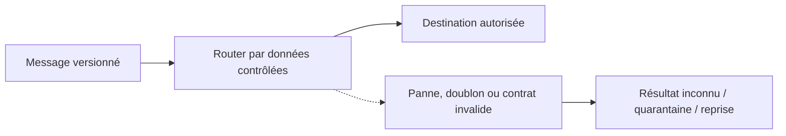
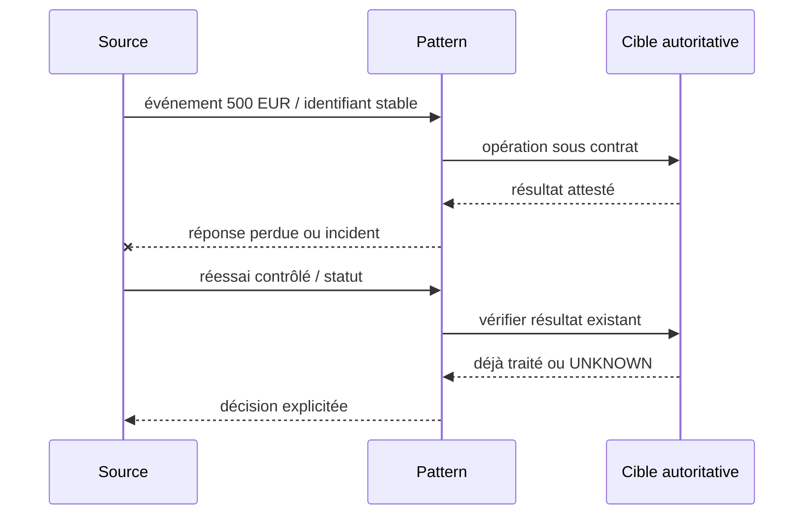
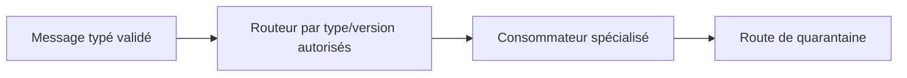
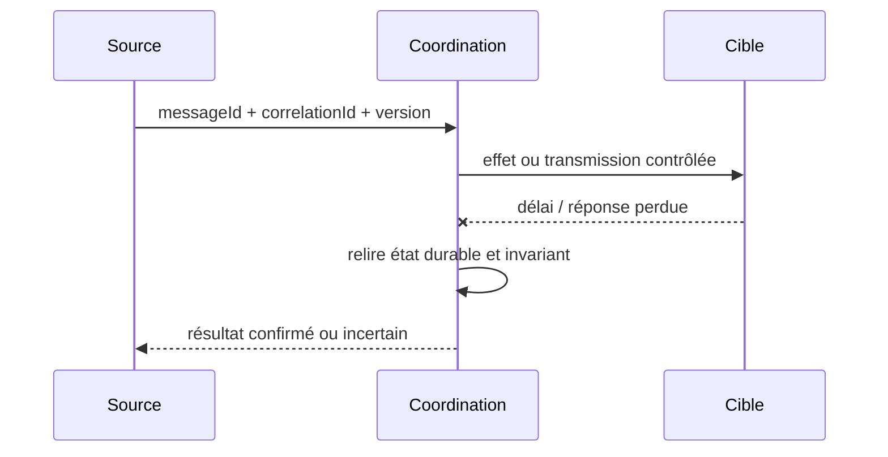

# Cours 96 — Content-Based Router · Enterprise Integration Patterns

> Cas pédagogique bancaire fictif : virement SEPA 500 EUR. Corrigé théorique, **quiz individuel non encore validé**.

## 1. Problème et intention
La banque doit gérer **Content-Based Router** lorsque les messages, traitements et contrats évoluent indépendamment. Un accusé de transport n'est pas un règlement financier.

**Contrat métier :** référence stable de l'ordre, messageId, correlationId, schemaVersion, deadline métier et propriétaire de chaque étape.

## 2. Scénario et HLD

**Choix architecturaux :** préciser unités de travail, rétention, idempotence, décision sur délai dépassé, ACL et observabilité.

## 3. Séquence de qualification

## 4. Invariants et risques
1. Type inconnu : quarantaine et jamais route par défaut dangereuse.
2. La propriété de la source autoritative ne se déduit pas de la présence de Kafka, d'IBM MQ ou d'un adaptateur.
3. Pour une commande, garantir absence de double effet avec un identifiant métier durable jusqu'au point d'exécution.
4. Pour les données ou événements, tester contrats, versions et identité du producteur.
5. Prévoir backlog, métriques, rejets, purge et preuve de reprise sans divulguer les données de paiement.

## 5. Tests
- Nominal : Destination autorisée, avec preuve observable.
- Panne : Type inconnu : quarantaine et jamais route par défaut dangereuse.
- Redélivrance et concurrence : aucune seconde opération non voulue.
- Sécurité : refus du message non autorisé et absence de fuite dans la DLQ.
- Migration : même signification des statuts avant et après versionnement.

## 6. QCM corrigé
**Quelle conception répond correctement à Content-Based Router dans notre banque ?**

- **A.** Supposer que Content-Based Router rend le paiement exactly-once sans autre contrôle.
- **B.** Utiliser Content-Based Router avec Router par données contrôlées et prouver la propriété Destination autorisée.
- **C.** Acquitter systématiquement un message avant son traitement pour éviter toute reprise.

**Bonne réponse : B.** Type inconnu : quarantaine et jamais route par défaut dangereuse. Le résultat doit être prouvé et les limites du pattern explicitées.

## 7. Fiche technique détaillée déjà présente dans le référentiel
[Ouvrir la source originale](https://github.com/zdmooc/enterprise-architecture-patterns-handbook/blob/main/18-enterprise-integration-patterns/03-content-based-router/README.md)

**Famille : Enterprise Integration Patterns.** Exemple indépendant, aucun système client réel.

#### Problème et forces

Un flux commun contient des types d'événements qui demandent des traitements différents. Les systèmes distribués redélivrent, échouent partiellement et possèdent des propriétaires de transaction différents.

#### Architecture

#### Séquence de panne à maîtriser

#### Invariant contractuel

Une règle explicite et versionnée associe (type, version) à une destination ; fallback refuse.

#### Conception et arbitrages

Valider schéma et identité émetteur avant classification; routage statique préférable aux scripts dynamiques. Prévoir contrat de compatibilité, ownership, audit et métriques avant le déploiement. Alternatives : traitement synchrone simple lorsque toléré, broker managé ou consolidation en monolithe si la distribution n'est pas justifiée.

#### Tests de défaillance exigés

1. **Panne après effet :** Message inconnu ou version incompatible va en quarantaine, jamais vers la route par défaut.
2. **Panne ou concurrence :** Modification de table de routage en vol : messages précédents gardent une destination déterministe.
3. **Sécurité :** schéma non reconnu, utilisateur non autorisé et charge malformée doivent être rejetés et journalisés sans fuite de données.

#### Limites et exploitation

Ne pas router par information sensible non validée ou sur du JSON non borné. Tracer messageId, route, version de règle et cause de refus sans payload sensible.

#### Question d'entretien

Comment démontrez-vous la sémantique métier malgré doublons, reprises et pertes de réponses ? Répondez par clé stable, état durable, invariant, tests injectés et preuve de replay.

[Catalogue EIP](https://github.com/zdmooc/enterprise-architecture-patterns-handbook/blob/main/18-enterprise-integration-patterns/README.md) · [Intégration existante](https://github.com/zdmooc/enterprise-architecture-patterns-handbook/blob/main/01-integration-patterns/04-event-driven-architecture/README.md)

[Retour à l'index](README.md)
