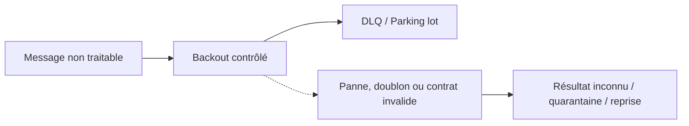
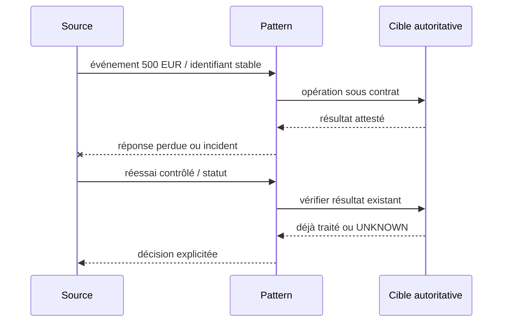
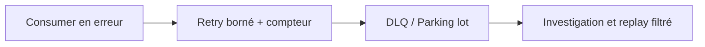
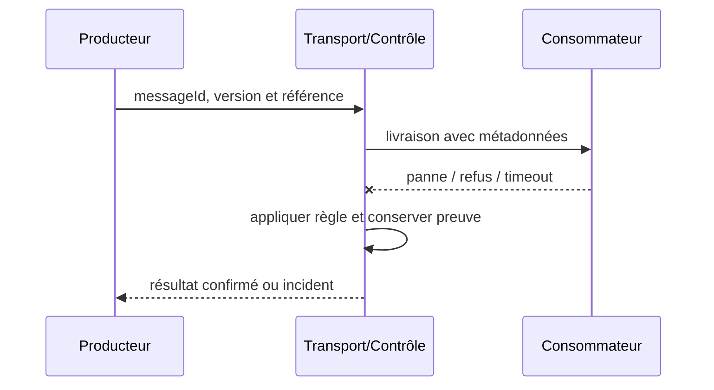

# Cours 99 — Dead Letter Channel / Parking Lot · Enterprise Integration Patterns

> Cas pédagogique bancaire fictif : virement SEPA 500 EUR. Corrigé théorique, **quiz individuel non encore validé**.

## 1. Problème et intention
La banque doit gérer **Dead Letter Channel / Parking Lot** lorsque les messages, traitements et contrats évoluent indépendamment. Un accusé de transport n'est pas un règlement financier.

**Contrat métier :** référence stable de l'ordre, messageId, correlationId, schemaVersion, deadline métier et propriétaire de chaque étape.

## 2. Scénario et HLD

**Choix architecturaux :** préciser unités de travail, rétention, idempotence, décision sur délai dépassé, ACL et observabilité.

## 3. Séquence de qualification

## 4. Invariants et risques
1. Redrive sans idempotence : effet financier potentiellement doublé.
2. La propriété de la source autoritative ne se déduit pas de la présence de Kafka, d'IBM MQ ou d'un adaptateur.
3. Pour une commande, garantir absence de double effet avec un identifiant métier durable jusqu'au point d'exécution.
4. Pour les données ou événements, tester contrats, versions et identité du producteur.
5. Prévoir backlog, métriques, rejets, purge et preuve de reprise sans divulguer les données de paiement.

## 5. Tests
- Nominal : DLQ / Parking lot, avec preuve observable.
- Panne : Redrive sans idempotence : effet financier potentiellement doublé.
- Redélivrance et concurrence : aucune seconde opération non voulue.
- Sécurité : refus du message non autorisé et absence de fuite dans la DLQ.
- Migration : même signification des statuts avant et après versionnement.

## 6. QCM corrigé
**Quelle conception répond correctement à Dead Letter Channel / Parking Lot dans notre banque ?**

- **A.** Supposer que Dead Letter Channel / Parking Lot rend le paiement exactly-once sans autre contrôle.
- **B.** Utiliser Dead Letter Channel / Parking Lot avec Backout contrôlé et prouver la propriété DLQ / Parking lot.
- **C.** Acquitter systématiquement un message avant son traitement pour éviter toute reprise.

**Bonne réponse : B.** Redrive sans idempotence : effet financier potentiellement doublé. Le résultat doit être prouvé et les limites du pattern explicitées.

## 7. Fiche technique détaillée déjà présente dans le référentiel
[Ouvrir la source originale](https://github.com/zdmooc/enterprise-architecture-patterns-handbook/blob/main/18-enterprise-integration-patterns/06-dead-letter-channel/README.md)

**Enterprise Integration Pattern complémentaire**, document de référence synthétique.

#### Contexte

Un message constamment invalide peut monopoliser les reprises d'un consommateur. Il faut maîtriser les frontières de fiabilité, d'identité, de version et de rétention.

#### Architecture

#### Séquence de test

#### Invariant

Identifier cause et version schéma, ne pas accepter relecture sans remédiation et idempotence.

#### Implémentation

Séparer erreurs transitoires vs définitives ; mettre une politique de max-attempts + backoff. Protéger les métadonnées tenant, chiffrer les charges sensibles, fixer un TTL et tracer correlationId sans divulguer de secret.

#### Tests obligatoires

1. **Injection d'incident** : Le même poison message réapparaît après redémarrage : aucune boucle illimitée.
2. **Reprise ou sécurité** : Une DLQ rejouée contient une instruction déjà exécutée : déduplication/investigation.
3. Contrôle CI : schéma invalide ou non autorisé doit échouer de façon explicite.

#### Compromis et exploitation

DLQ n'est pas une poubelle : rétention, contrôle d'accès et redaction obligatoire. KPIs : âge du plus vieux, DLQ par cause, backlog, temps de remédiation. Un ACK ne prouve pas que la décision métier est validée.

#### Question d'entretien

Comment limiter les effets de bord et prouver une reprise cohérente si le message est en doublon, perdu ou incompatible ?

[Catalogue](https://github.com/zdmooc/enterprise-architecture-patterns-handbook/blob/main/18-enterprise-integration-patterns/README.md) · [EDA existante](https://github.com/zdmooc/enterprise-architecture-patterns-handbook/blob/main/01-integration-patterns/04-event-driven-architecture/README.md)

[Retour à l'index](README.md)
