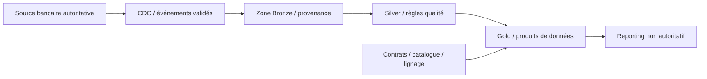
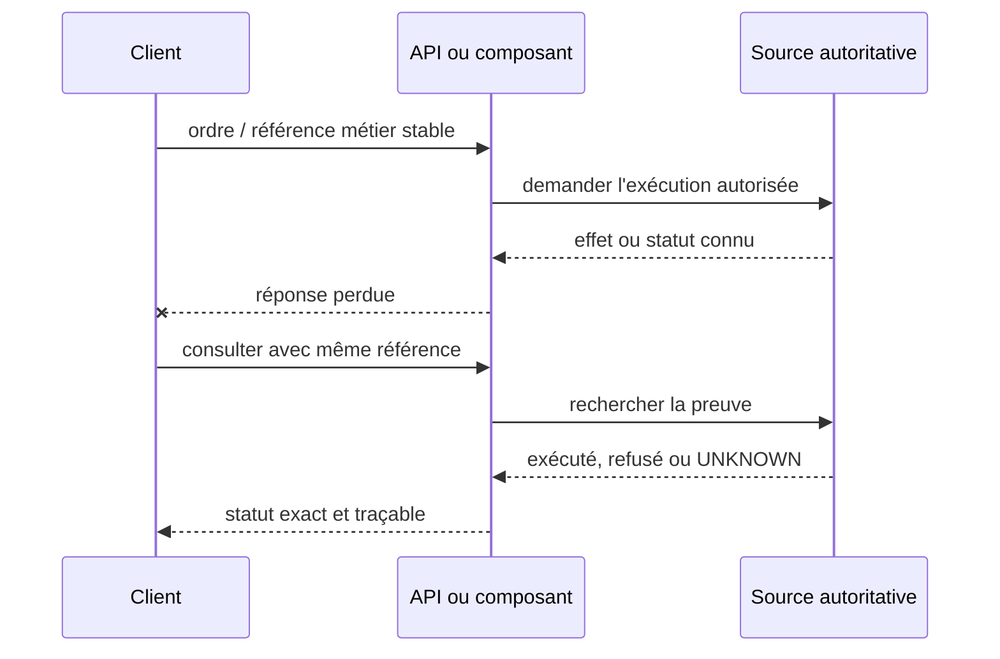

# Architecture de synthèse — Données · cours 102–113

> Cas fictif, proposé pour apprendre et tester des hypothèses, non applicable sans qualification à une plateforme bancaire réelle.

## Frontières et invariants
1. La source d'un règlement reste le système autoritatif, pas le HTTP, un broker, une vue analytics ou un pod.
2. Toute commande et sa reprise sont identifiées par une référence métier stable.
3. Les données sensibles ont un propriétaire, une durée de rétention et des contrôles d'accès explicites.
4. Les opérations critiques requièrent une politique de traitement de la concurrence et des partitions.
5. La modification d'un schéma ou contrat ne doit pas changer silencieusement la signification d'un statut.
6. RTO, RPO, p95/p99, backlog, fraîcheur et coûts sont mesurés par des preuves reproductibles.

## Séquence de réponse perdue

## Qualification GO/NO-GO
| Incident | Test d'injection | Propriété à prouver |
|---|---|---|
| Crash après commit | Arrêter composant entre effet et réponse | Pas de second effet |
| Message dupliqué | Deux livraisons concurrentes | Idempotence au point autoritatif |
| Partition réseau | Isoler writer/leader | Absence de double autorité |
| Flux obsolète | Retarder la réplication/projection | Fraîcheur et provenance explicites |
| Accès transversal | Lire l'ordre d'un tiers | Refus sans fuite |
| Reprise site | Réexécuter runbook | RTO/RPO réels et réconciliation |

[Programme des cours](../README.md) · [Exercices](../exercices-et-corriges/cours-102-113.md)
