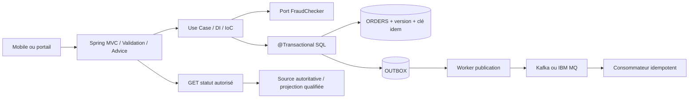
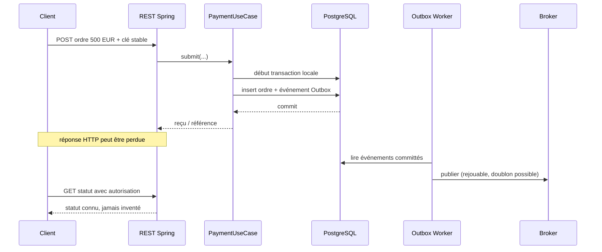

# Architecture de synthèse — Java/Spring : initiation SEPA fictive 500 EUR

> Cas pédagogique, non représentatif d'un établissement. Les composants financiers et les statuts demeurent sous l'autorité des systèmes habilités.

## Structure

## Séquence transactionnelle et réponse perdue

## Arbitrages
- `202 Accepted` peut indiquer une demande en traitement ; ne signifie ni acceptation financière ni règlement.
- L'autorité de règlement ne dépend pas de Spring ni du broker.
- Les transactions SQL et broker ne sont pas atomiques du seul fait de `@Transactional`.
- L'Outbox peut émettre plusieurs fois : déduplication et idempotence jusqu'à l'exécution.
- Isolation des données et droits objet obligatoires ; pas de secrets dans les configurations versionnées.
- Liveness/readiness, arrêt et reprise après redémarrage sur OpenShift à qualifier.
- Les métriques, observations et vues ne doivent pas remplacer l'audit financier source de vérité.

## Tests GO/NO-GO
1. Requête répétée après timeout et commit : pas de deuxième ordre.
2. Erreur SQL avant Outbox : rollback commun.
3. Panne de broker : Outbox non perdue, reprise ensuite.
4. Doublon de publication : un seul effet métier.
5. État incomplet dans projection : information « en cours/inconnue » plutôt que faux règlement.
6. Cinq pods : aucune donnée d'ordre stockée dans des champs singleton.
7. Accès à l'ordre d'un autre client : refus par la source autorisée.
8. Configuration invalide et secret indisponible : démarrage ou service non prêt selon politique.

[Programme 74–83](../README.md) · [Cahier de révision](../exercices-et-corriges/cours-74-83.md)
