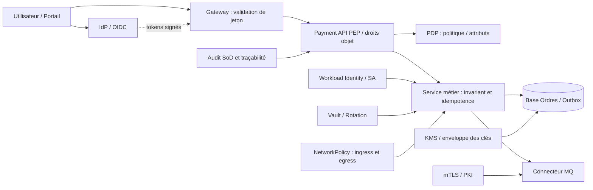
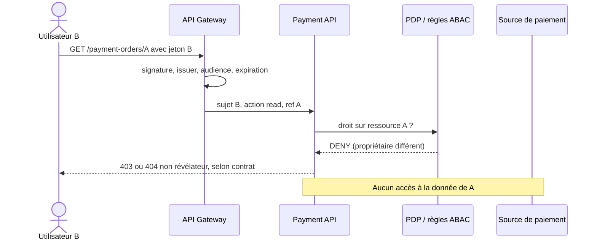
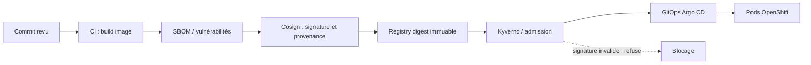

# Architecture de synthèse — Sécurité Zero Trust, cours 129–140

> Banque fictive · paiement SEPA 500 EUR · architecture illustrative Java/Spring/OpenShift. Aucun système client ou environnement réel n'est décrit.

## 1. Chaîne d'accès et responsabilités

Les flèches représentent des responsabilités logiques. Elles n'affirment pas que toutes les technologies citées sont nécessaires simultanément à chaque architecture.

## 2. Séquence : tentative de BOLA

## 3. Chaîne d'image logicielle : même digest

## 4. Décisions d'architecture à justifier
- Identité : attributs dignes de confiance et fenêtre de révocation mesurable pour sessions et workloads.
- Autorisation : rôle, objet, tenant et contexte ; PEP appliqué dans le chemin de service ; tests directs hors Gateway.
- Confidentialité : mTLS/CA et KMS, sans confondre chiffrement, identité et permission métier.
- Réseau : default deny puis exceptions ingress et egress strictement nécessaires ; vérification DNS, endpoints et comportement du CNI.
- Secrets : coffre et rotation démontrée, aucun secret immuable dans Git ou image.
- Chaîne logicielle : attestation et signature vérifiées sur digest exact ; scans récurrents et patch SLA.
- Audit : SoD pour actions sensibles, traces protégées contre suppression et comptes de service distincts.
- Disponibilité : refus contrôlé en cas d'absence de décision d'accès, sans inventer ni paiement réglé ni rejeté.

## 5. Critères GO/NO-GO du laboratoire
| Scénario | Attendu |
|---|---|
| Sans jeton | 401 au contrôle prévu |
| Jeton valide, audience erronée | 401 |
| Scope insuffisant | 403 |
| Utilisateur B sur ordre A | Refus (403 ou 404 non révélateur selon politique) |
| Appel direct service contournant Gateway | Refus |
| Pod intrus vers DB paiement | Refus réseau |
| Certificat expiré ou autre CA | Échec de handshake |
| Secret révoqué | Nouvelle connexion impossible dans fenêtre établie |
| Image au digest non signé | Admission interdite |
| Auto-approbation de correction | Refus et preuve d'audit |
| Panne PDP | Politique documentée sans accord financier par défaut |

**Statut :** plan de qualification documentaire ; aucune exécution de ces tests n'est revendiquée.

[Programme complet](../README.md) · [Cahier QCM](../exercices-et-corriges/cours-129-140.md)
