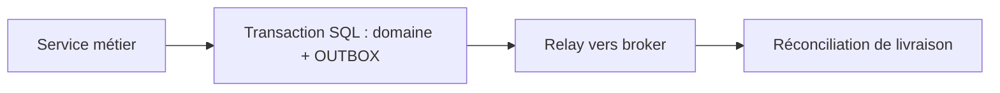
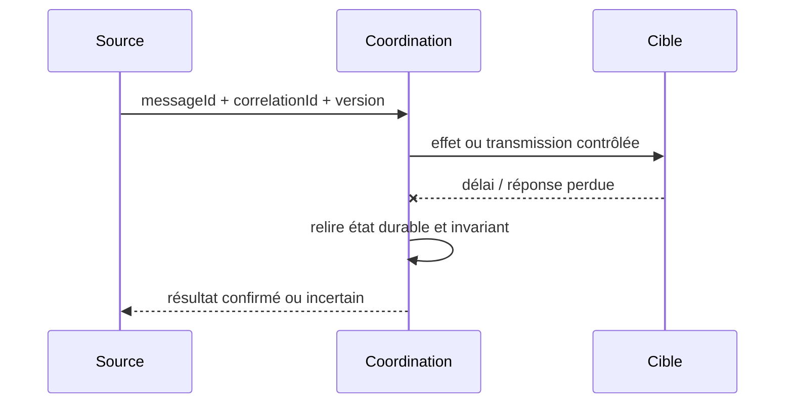

# Transactional Outbox

**Famille : Enterprise Integration Patterns.** Exemple indépendant, aucun système client réel.

## Problème et forces

Une transaction modifie la base puis doit notifier d'autres services : une publication directe après COMMIT peut être perdue. Les systèmes distribués redélivrent, échouent partiellement et possèdent des propriétaires de transaction différents.

## Architecture

## Séquence de panne à maîtriser

## Invariant contractuel

Clé de l'événement stable, unicité de publication logique et index sur statut/nextAttemptAt.

## Conception et arbitrages

Transaction locale métier+outbox, polling relay ou CDC, publication avec clé d'agrégat et ACK broker avant marquage livré. Prévoir contrat de compatibilité, ownership, audit et métriques avant le déploiement. Alternatives : traitement synchrone simple lorsque toléré, broker managé ou consolidation en monolithe si la distribution n'est pas justifiée.

## Tests de défaillance exigés

1. **Panne après effet :** Crash immédiatement après COMMIT avant publication ; un relay reprend le même eventId.
2. **Panne ou concurrence :** Broker momentanément indisponible : backlog durable, retries bornés et alerte lag.
3. **Sécurité :** schéma non reconnu, utilisateur non autorisé et charge malformée doivent être rejetés et journalisés sans fuite de données.

## Limites et exploitation

Ne garantit pas livraison unique du transport : les consommateurs restent idempotents. Mesurer backlog, publication et duplications; purger seulement après rétention contrôlée.

## Question d'entretien

Comment démontrez-vous la sémantique métier malgré doublons, reprises et pertes de réponses ? Répondez par clé stable, état durable, invariant, tests injectés et preuve de replay.

[Catalogue EIP](../README.md) · [Intégration existante](../../01-integration-patterns/04-event-driven-architecture/README.md)
