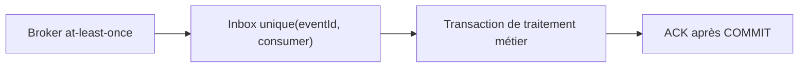
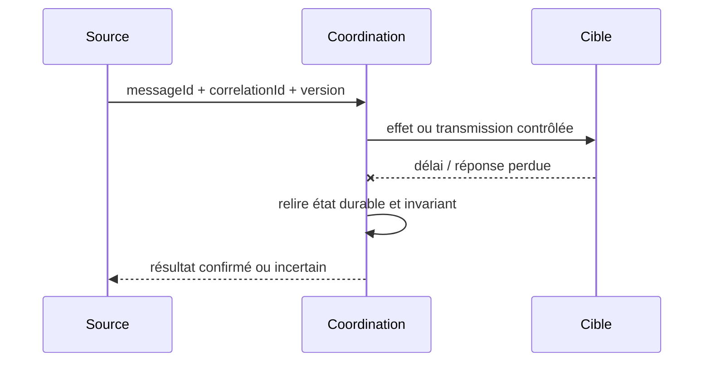

# Transactional Inbox / Idempotent Consumer

**Famille : Enterprise Integration Patterns.** Exemple indépendant, aucun système client réel.

## Problème et forces

Un broker redélivre la même commande après timeout ou crash : traiter deux fois produirait un second effet. Les systèmes distribués redélivrent, échouent partiellement et possèdent des propriétaires de transaction différents.

## Architecture

## Séquence de panne à maîtriser

## Invariant contractuel

Contrainte d'unicité de la clé événement + consommateur dans la même transaction que l'effet.

## Conception et arbitrages

Conserver provenance, hash du payload et durée de rétention; distinguer doublon exact de collision divergente. Prévoir contrat de compatibilité, ownership, audit et métriques avant le déploiement. Alternatives : traitement synchrone simple lorsque toléré, broker managé ou consolidation en monolithe si la distribution n'est pas justifiée.

## Tests de défaillance exigés

1. **Panne après effet :** Même message livré deux fois, simultanément : un seul enregistrement métier.
2. **Panne ou concurrence :** Crash après COMMIT et avant ACK : le redelivery constate traité et acquitte.
3. **Sécurité :** schéma non reconnu, utilisateur non autorisé et charge malformée doivent être rejetés et journalisés sans fuite de données.

## Limites et exploitation

Une clé de déduplication basée uniquement sur le corps peut masquer des événements légitimes. Tester concurrence sur PostgreSQL et récupération après interruption réseau.

## Question d'entretien

Comment démontrez-vous la sémantique métier malgré doublons, reprises et pertes de réponses ? Répondez par clé stable, état durable, invariant, tests injectés et preuve de replay.

[Catalogue EIP](../README.md) · [Intégration existante](../../01-integration-patterns/04-event-driven-architecture/README.md)
