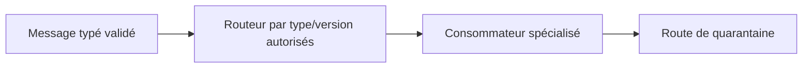
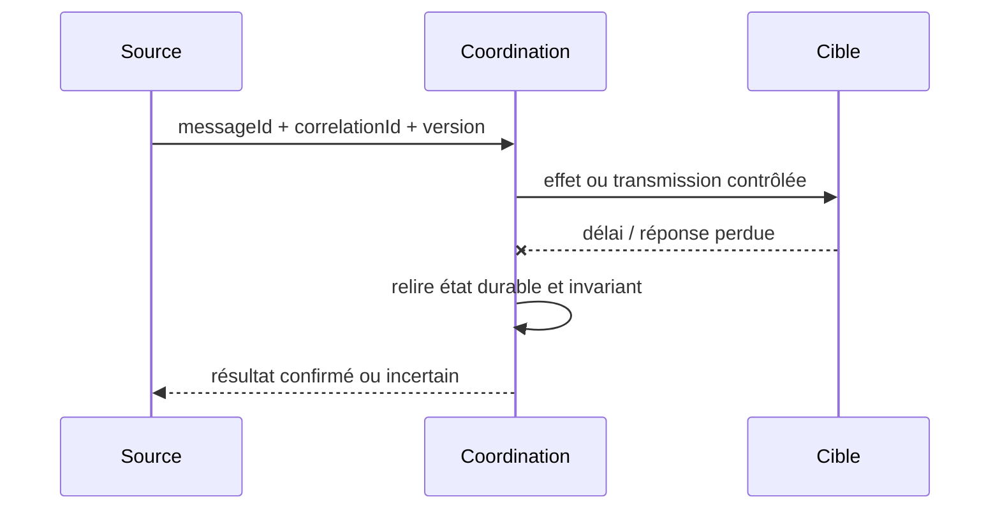

# Content-Based Router

**Famille : Enterprise Integration Patterns.** Exemple indépendant, aucun système client réel.

## Problème et forces

Un flux commun contient des types d'événements qui demandent des traitements différents. Les systèmes distribués redélivrent, échouent partiellement et possèdent des propriétaires de transaction différents.

## Architecture

## Séquence de panne à maîtriser

## Invariant contractuel

Une règle explicite et versionnée associe (type, version) à une destination ; fallback refuse.

## Conception et arbitrages

Valider schéma et identité émetteur avant classification; routage statique préférable aux scripts dynamiques. Prévoir contrat de compatibilité, ownership, audit et métriques avant le déploiement. Alternatives : traitement synchrone simple lorsque toléré, broker managé ou consolidation en monolithe si la distribution n'est pas justifiée.

## Tests de défaillance exigés

1. **Panne après effet :** Message inconnu ou version incompatible va en quarantaine, jamais vers la route par défaut.
2. **Panne ou concurrence :** Modification de table de routage en vol : messages précédents gardent une destination déterministe.
3. **Sécurité :** schéma non reconnu, utilisateur non autorisé et charge malformée doivent être rejetés et journalisés sans fuite de données.

## Limites et exploitation

Ne pas router par information sensible non validée ou sur du JSON non borné. Tracer messageId, route, version de règle et cause de refus sans payload sensible.

## Question d'entretien

Comment démontrez-vous la sémantique métier malgré doublons, reprises et pertes de réponses ? Répondez par clé stable, état durable, invariant, tests injectés et preuve de replay.

[Catalogue EIP](../README.md) · [Intégration existante](../../01-integration-patterns/04-event-driven-architecture/README.md)
