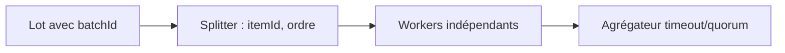
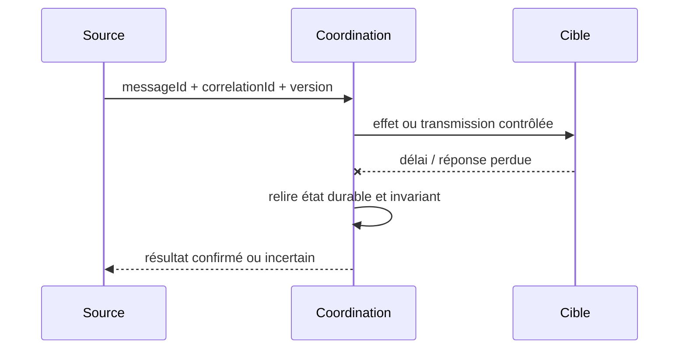

# Splitter / Aggregator avec corrélation

**Famille : Enterprise Integration Patterns.** Exemple indépendant, aucun système client réel.

## Problème et forces

Un lot de commandes ou documents doit être traité en unités parallèles puis rapproché. Les systèmes distribués redélivrent, échouent partiellement et possèdent des propriétaires de transaction différents.

## Architecture

## Séquence de panne à maîtriser

## Invariant contractuel

Chaque sous-message porte batchId/itemId ; agrégateur persiste les réponses et refuse les doublons.

## Conception et arbitrages

Définir taille maximale, expiration, contrat sur partial/fail, limites concurrency et reprise. Prévoir contrat de compatibilité, ownership, audit et métriques avant le déploiement. Alternatives : traitement synchrone simple lorsque toléré, broker managé ou consolidation en monolithe si la distribution n'est pas justifiée.

## Tests de défaillance exigés

1. **Panne après effet :** Une réponse manque : état PARTIAL explicite et récupération ciblée, jamais succès du lot.
2. **Panne ou concurrence :** Résultats arrivent désordonnés ou en doublon : agrégation déterministe par itemId.
3. **Sécurité :** schéma non reconnu, utilisateur non autorisé et charge malformée doivent être rejetés et journalisés sans fuite de données.

## Limites et exploitation

Une agrégation ne forme pas une transaction ACID entre les systèmes appelés. Mesurer p99, mémoire des agrégateurs, taux PARTIAL, retries par sous-message.

## Question d'entretien

Comment démontrez-vous la sémantique métier malgré doublons, reprises et pertes de réponses ? Répondez par clé stable, état durable, invariant, tests injectés et preuve de replay.

[Catalogue EIP](../README.md) · [Intégration existante](../../01-integration-patterns/04-event-driven-architecture/README.md)
