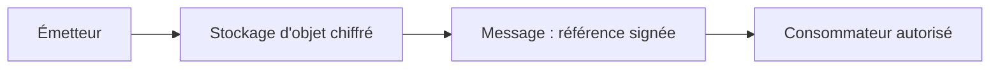
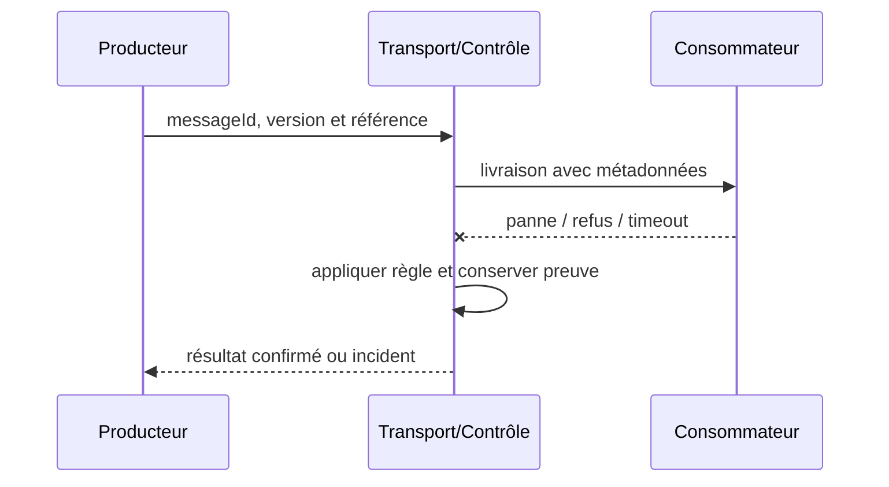

# Claim Check

**Enterprise Integration Pattern complémentaire**, document de référence synthétique.

## Contexte

Un message contient une pièce trop volumineuse pour le broker. Il faut maîtriser les frontières de fiabilité, d'identité, de version et de rétention.

## Architecture

## Séquence de test

## Invariant

Référence opaque, TTL, hash de contenu et identité de tenant obligatoires.

## Implémentation

Enregistrer charge avant publication atomique de référence; obtenir contenu par URL éphémère/identité workload. Protéger les métadonnées tenant, chiffrer les charges sensibles, fixer un TTL et tracer correlationId sans divulguer de secret.

## Tests obligatoires

1. **Injection d'incident** : Objet expiré avant consommation : erreur explicite puis quarantaine.
2. **Reprise ou sécurité** : Objet falsifié ou inter-tenant : rejet avant lecture.
3. Contrôle CI : schéma invalide ou non autorisé doit échouer de façon explicite.

## Compromis et exploitation

Un objet stocké n'est pas automatiquement supprimé après ACK; gérer purge et RGPD. Mesurer objets orphelins, expirations, taille et erreurs de récupération. Un ACK ne prouve pas que la décision métier est validée.

## Question d'entretien

Comment limiter les effets de bord et prouver une reprise cohérente si le message est en doublon, perdu ou incompatible ?

[Catalogue](../README.md) · [EDA existante](../../01-integration-patterns/04-event-driven-architecture/README.md)
