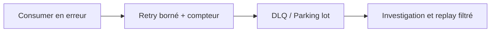
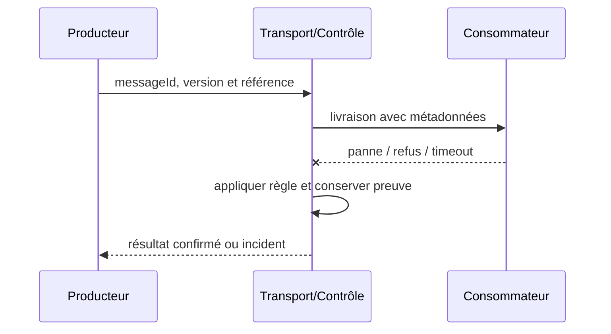

# Dead Letter Channel & Parking Lot

**Enterprise Integration Pattern complémentaire**, document de référence synthétique.

## Contexte

Un message constamment invalide peut monopoliser les reprises d'un consommateur. Il faut maîtriser les frontières de fiabilité, d'identité, de version et de rétention.

## Architecture

## Séquence de test

## Invariant

Identifier cause et version schéma, ne pas accepter relecture sans remédiation et idempotence.

## Implémentation

Séparer erreurs transitoires vs définitives ; mettre une politique de max-attempts + backoff. Protéger les métadonnées tenant, chiffrer les charges sensibles, fixer un TTL et tracer correlationId sans divulguer de secret.

## Tests obligatoires

1. **Injection d'incident** : Le même poison message réapparaît après redémarrage : aucune boucle illimitée.
2. **Reprise ou sécurité** : Une DLQ rejouée contient une instruction déjà exécutée : déduplication/investigation.
3. Contrôle CI : schéma invalide ou non autorisé doit échouer de façon explicite.

## Compromis et exploitation

DLQ n'est pas une poubelle : rétention, contrôle d'accès et redaction obligatoire. KPIs : âge du plus vieux, DLQ par cause, backlog, temps de remédiation. Un ACK ne prouve pas que la décision métier est validée.

## Question d'entretien

Comment limiter les effets de bord et prouver une reprise cohérente si le message est en doublon, perdu ou incompatible ?

[Catalogue](../README.md) · [EDA existante](../../01-integration-patterns/04-event-driven-architecture/README.md)
