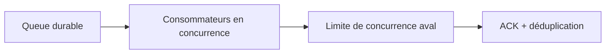
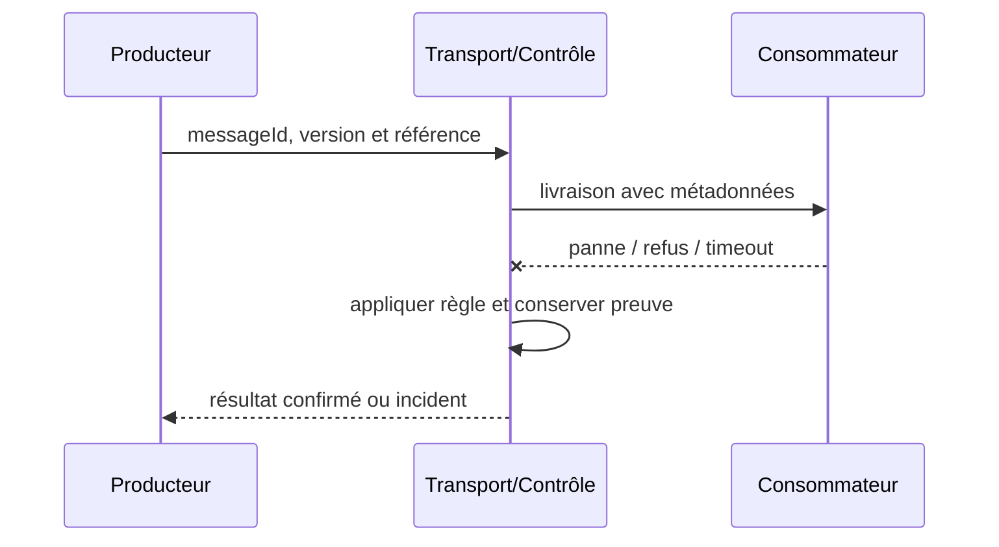

# Competing Consumers / Work Queue

**Enterprise Integration Pattern complémentaire**, document de référence synthétique.

## Contexte

Des traitements indépendants doivent absorber des pics avec plusieurs workers. Il faut maîtriser les frontières de fiabilité, d'identité, de version et de rétention.

## Architecture

## Séquence de test

## Invariant

La même tâche est exécutée au plus une fois au niveau effet métier, pas nécessairement délivrée une fois.

## Implémentation

Régler prefetch, visibility timeout, concurrence totale et quota aval; limiter la montée d'échelle. Protéger les métadonnées tenant, chiffrer les charges sensibles, fixer un TTL et tracer correlationId sans divulguer de secret.

## Tests obligatoires

1. **Injection d'incident** : Stopper un worker après prise en charge : livraison et reprise sur un autre.
2. **Reprise ou sécurité** : Doubler réplicas au-delà de la DB : backpressure empêche épuisement du pool.
3. Contrôle CI : schéma invalide ou non autorisé doit échouer de façon explicite.

## Compromis et exploitation

L'ordre global n'est pas garanti avec plusieurs consumers ; partitionner si nécessaire. Mesurer backlog, âge, lag, saturation DB et taux de retries. Un ACK ne prouve pas que la décision métier est validée.

## Question d'entretien

Comment limiter les effets de bord et prouver une reprise cohérente si le message est en doublon, perdu ou incompatible ?

[Catalogue](../README.md) · [EDA existante](../../01-integration-patterns/04-event-driven-architecture/README.md)
