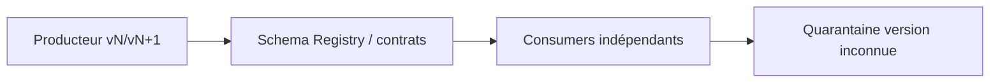
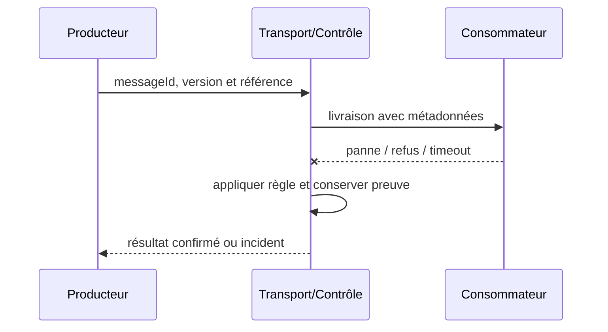

# Event Schema Evolution / Compatibility Gate

**Enterprise Integration Pattern complémentaire**, document de référence synthétique.

## Contexte

Un producteur versionne un événement alors que les consommateurs déploient à des cadences différentes. Il faut maîtriser les frontières de fiabilité, d'identité, de version et de rétention.

## Architecture

## Séquence de test

## Invariant

Évolution additive compatible et validation transitive selon politique de consommateurs.

## Implémentation

Prévoir versions, data classification, règles de compatibilité backward/forward, période de coexistence. Protéger les métadonnées tenant, chiffrer les charges sensibles, fixer un TTL et tracer correlationId sans divulguer de secret.

## Tests obligatoires

1. **Injection d'incident** : Supprimer champ nécessaire avant migration : CI contract bloque release.
2. **Reprise ou sécurité** : Un consumer ancien reçoit vN+1 : lit sans perdre sens ni données obligatoires.
3. Contrôle CI : schéma invalide ou non autorisé doit échouer de façon explicite.

## Compromis et exploitation

Une compatibilité JSON de structure ne garantit pas l'équivalence sémantique métier. Prouver consumer-driven contracts et métriques de rejet par schemaVersion. Un ACK ne prouve pas que la décision métier est validée.

## Question d'entretien

Comment limiter les effets de bord et prouver une reprise cohérente si le message est en doublon, perdu ou incompatible ?

[Catalogue](../README.md) · [EDA existante](../../01-integration-patterns/04-event-driven-architecture/README.md)
