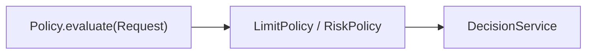
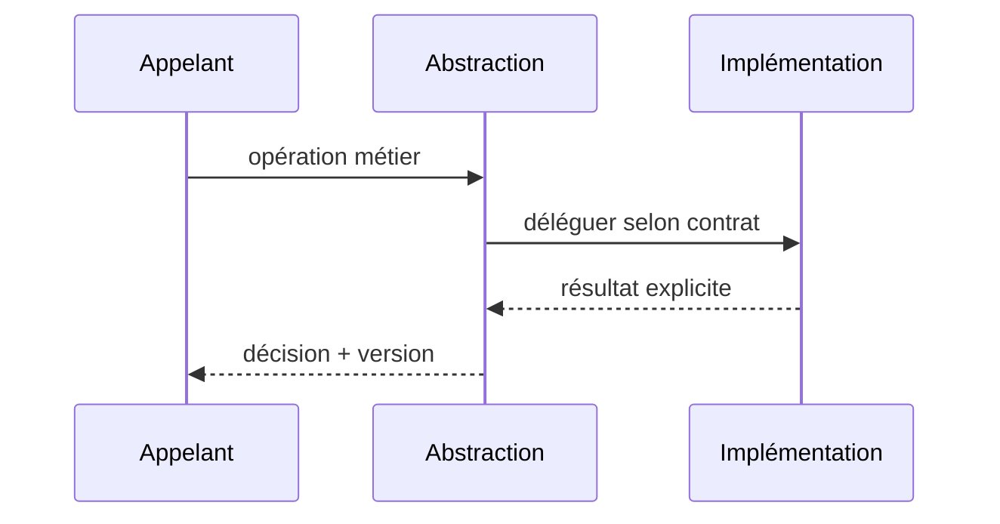

# Strategy — GoF / Java 17

**Catégorie : design pattern logiciel, pas une architecture distribuée complète.**

## Problème

Choisir une politique de décision selon le contexte sans modifier le service d'appel.

## Structure



## Contrat Java (simplifié)

```java
`interface Policy { Decision evaluate(Request r); }`
```

## Séquence



## Invariant et tests

**Invariant :** Changer politique par configuration versionnée plutôt que par if métiers dispersés.

1. Tester choix nominal et deux variantes de stratégie/produit/commande.
2. Tester absence de configuration et fail-closed : Sélection profil inconnu refusée ; aucun profil par défaut permissif.
3. Tester latence et erreurs : la classe appelante ne doit pas dépendre d'une implémentation spécifique.

## Compromis

Une stratégie modifie le résultat : journaliser règle/version et tests Golden Master. Ne pas introduire d'abstraction si une seule implémentation restera durablement suffisante.

[Catalogue GoF](../README.md) · [Lab JDK 17](../../labs/java-gof/README.md)
