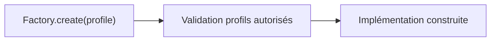
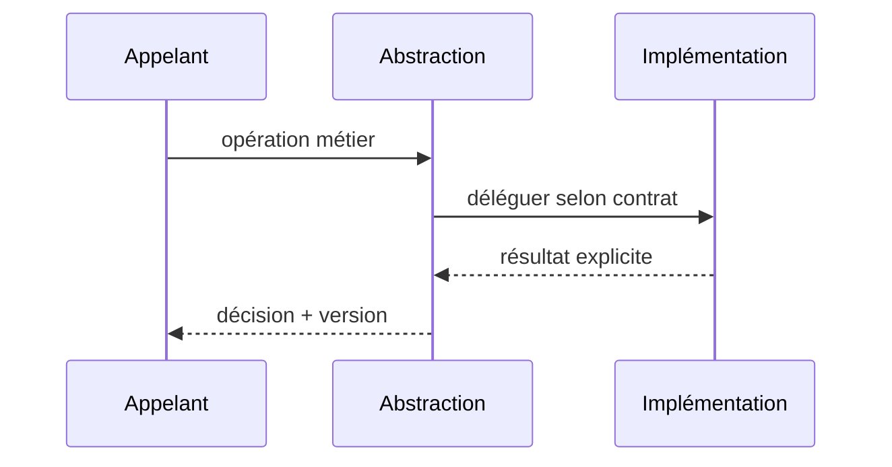

# Factory Method — GoF / Java 17

**Catégorie : design pattern logiciel, pas une architecture distribuée complète.**

## Problème

Instancier des adaptateurs sous contrôle sans coupler le métier aux classes concrètes.

## Structure



## Contrat Java (simplifié)

```java
`Policy create(String p) { return switch(p) { case "strict" -> new StrictPolicy(); default -> throw new IllegalArgumentException(); }; }`
```

## Séquence



## Invariant et tests

**Invariant :** Les profils non connus provoquent une erreur explicite plutôt qu'un fallback silencieux.

1. Tester choix nominal et deux variantes de stratégie/produit/commande.
2. Tester absence de configuration et fail-closed : Règle factory défectueuse : test couvre toutes les variantes de profils.
3. Tester latence et erreurs : la classe appelante ne doit pas dépendre d'une implémentation spécifique.

## Compromis

Factory est de la construction ; pas un registre global mutable de services. Ne pas introduire d'abstraction si une seule implémentation restera durablement suffisante.

[Catalogue GoF](../README.md) · [Lab JDK 17](../../labs/java-gof/README.md)
