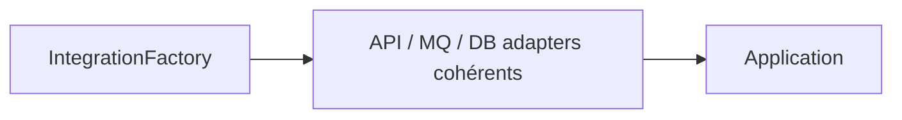
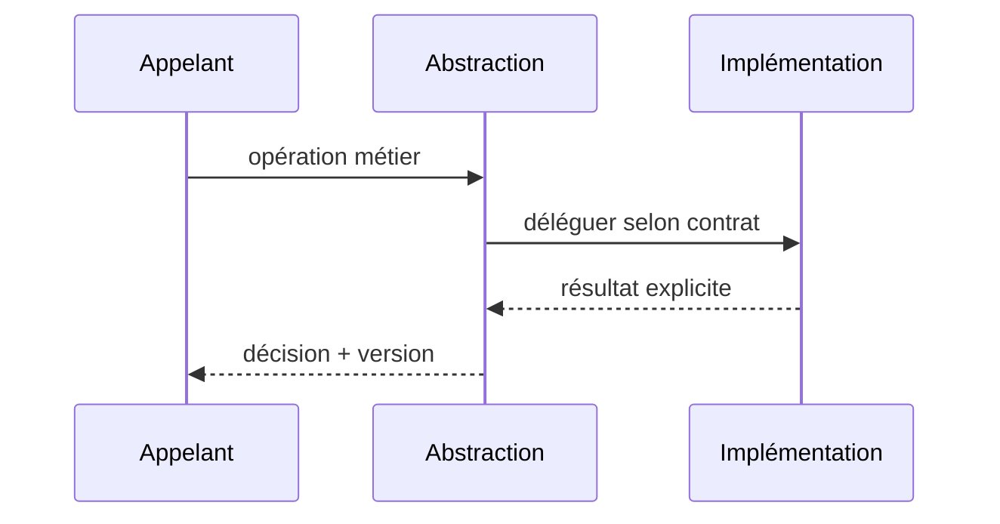

# Abstract Factory — GoF / Java 17

**Catégorie : design pattern logiciel, pas une architecture distribuée complète.**

## Problème

Créer une famille compatible de clients d'intégration pour un environnement.

## Structure



## Contrat Java (simplifié)

```java
`interface IntegrationFactory { PaymentPort payment(); AuditPort audit(); }`
```

## Séquence



## Invariant et tests

**Invariant :** Un même environnement produit seulement des adaptateurs contractuellement compatibles.

1. Tester choix nominal et deux variantes de stratégie/produit/commande.
2. Tester absence de configuration et fail-closed : Fournisseur MQ remplacé : tests de contrats identiques pour deux familles.
3. Tester latence et erreurs : la classe appelante ne doit pas dépendre d'une implémentation spécifique.

## Compromis

Ne pas faire porter les décisions métier par la factory. Ne pas introduire d'abstraction si une seule implémentation restera durablement suffisante.

[Catalogue GoF](../README.md) · [Lab JDK 17](../../labs/java-gof/README.md)
