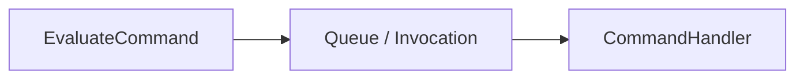
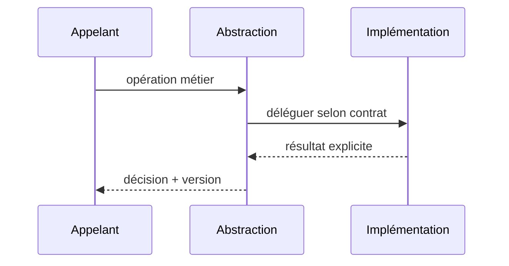

# Command — GoF / Java 17

**Catégorie : design pattern logiciel, pas une architecture distribuée complète.**

## Problème

Découpler une intention métier de son transport et de son exécution contrôlée.

## Structure



## Contrat Java (simplifié)

```java
`interface Command<R> { R execute(); }`
```

## Séquence



## Invariant et tests

**Invariant :** Une commande est une intention identifiée, pas une preuve que son effet a réussi.

1. Tester choix nominal et deux variantes de stratégie/produit/commande.
2. Tester absence de configuration et fail-closed : Reprise redélivre la commande : handler protège idempotence par référence.
3. Tester latence et erreurs : la classe appelante ne doit pas dépendre d'une implémentation spécifique.

## Compromis

Une Command GoF seule ne garantit pas Outbox, persistence ni saga. Ne pas introduire d'abstraction si une seule implémentation restera durablement suffisante.

[Catalogue GoF](../README.md) · [Lab JDK 17](../../labs/java-gof/README.md)
