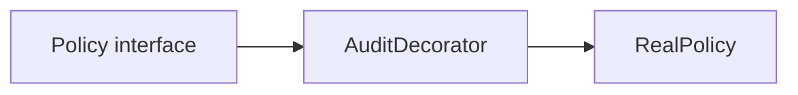
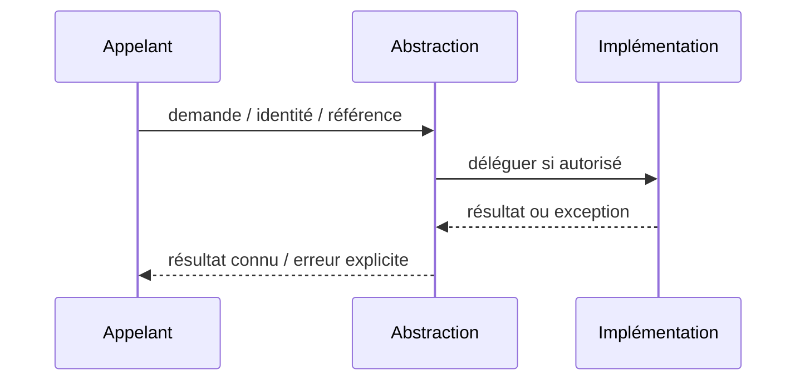

# Decorator — Design Pattern GoF

**Rôle : composition logicielle Java/JEE** ; ne constitue ni un pattern d'intégration distribué ni une garantie de HA.

## Besoin réel

Ajouter une responsabilité (audit, métrique) sans modifier le moteur métier.

## Structure UML simplifiée



## Exemple Java orienté contrat

```java
`final class AuditPolicy implements Policy { private final Policy next; public Decision evaluate(Request r) { var d=next.evaluate(r); audit(d); return d; } }`
```

## Séquence et erreur



## Invariants et tests

- Le résultat retourné par le décorateur doit rester celui du moteur, sauf erreur explicite de la politique choisie.
- **Négatif :** Une exception de journalisation ne doit pas masquer un résultat critique déjà committé sans politique définie.
- Mesurer p95/p99 ou absence d'effet de bord ; documenter comportement sous erreur.

## Compromis

Pas de chaîne de decorators opaque sans budget de latence. Comparer à un appel direct et ajouter l'abstraction uniquement si elle protège un besoin d'évolution prouvé.

[Catalogue GoF](../README.md) · [Lab compilable](../../labs/java-gof/README.md)
