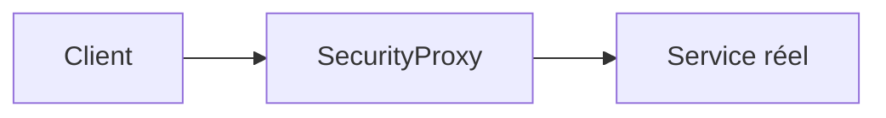
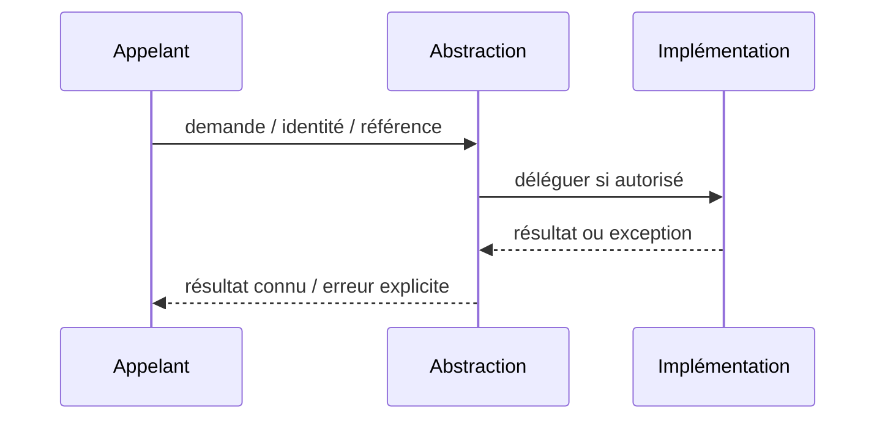

# Proxy / Protection Proxy — Design Pattern GoF

**Rôle : composition logicielle Java/JEE** ; ne constitue ni un pattern d'intégration distribué ni une garantie de HA.

## Besoin réel

Intercepter un appel pour appliquer le contrôle d'accès côté service.

## Structure UML simplifiée



## Exemple Java orienté contrat

```java
`Decision evaluate(Request r) { if (!allowed(r)) throw new SecurityException(); return target.evaluate(r); }`
```

## Séquence et erreur



## Invariants et tests

- Vérifier rôle et droits objet avant tout effet; aucune confiance dans la seule passerelle.
- **Négatif :** Utilisateur sans droit tente appel direct: aucun accès au service réel.
- Mesurer p95/p99 ou absence d'effet de bord ; documenter comportement sous erreur.

## Compromis

Pour le réseau, ce pattern ne remplace pas IAM, mTLS ni politiques PDP/PEP. Comparer à un appel direct et ajouter l'abstraction uniquement si elle protège un besoin d'évolution prouvé.

[Catalogue GoF](../README.md) · [Lab compilable](../../labs/java-gof/README.md)
