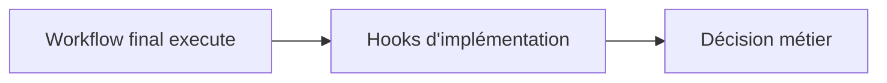
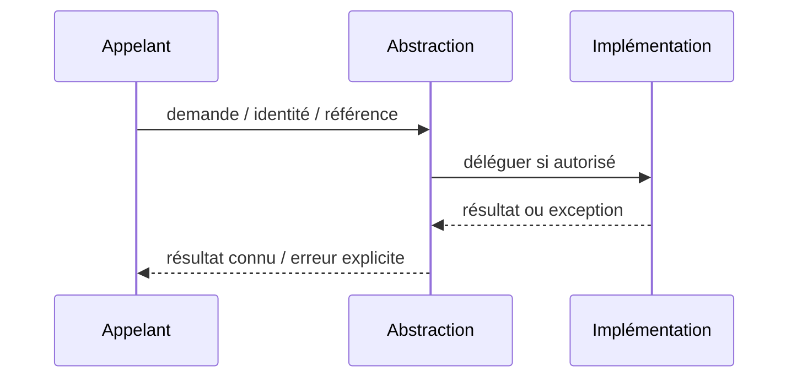

# Template Method — Design Pattern GoF

**Rôle : composition logicielle Java/JEE** ; ne constitue ni un pattern d'intégration distribué ni une garantie de HA.

## Besoin réel

Fixer l'ordre validation -> exécution -> contrôle en laissant varier les étapes.

## Structure UML simplifiée



## Exemple Java orienté contrat

```java
`public final Decision execute(Request r) { validate(r); return compute(r); }`
```

## Séquence et erreur



## Invariants et tests

- La validation précède l'effet et ne peut être contournée par une sous-classe.
- **Négatif :** Une étape d'implémentation lève une exception : aucun résultat faux positif.
- Mesurer p95/p99 ou absence d'effet de bord ; documenter comportement sous erreur.

## Compromis

Préférer composition si hiérarchie de classes complexe. Comparer à un appel direct et ajouter l'abstraction uniquement si elle protège un besoin d'évolution prouvé.

[Catalogue GoF](../README.md) · [Lab compilable](../../labs/java-gof/README.md)
