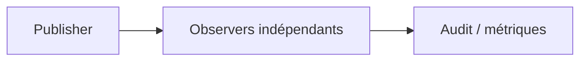
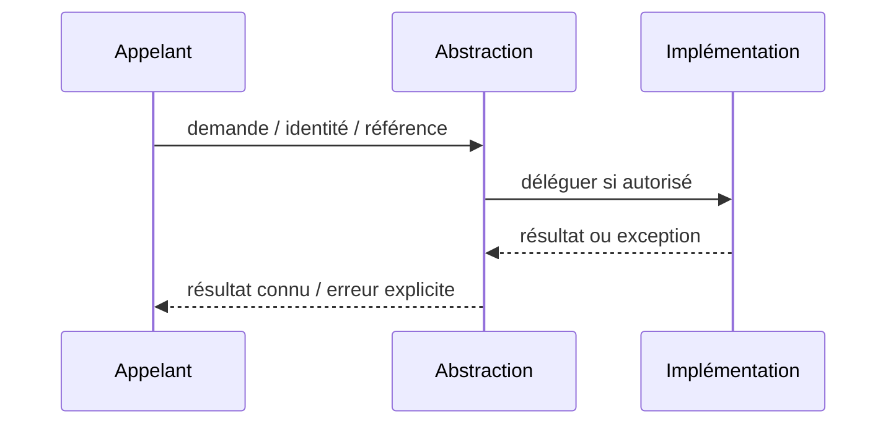

# Observer — Design Pattern GoF

**Rôle : composition logicielle Java/JEE** ; ne constitue ni un pattern d'intégration distribué ni une garantie de HA.

## Besoin réel

Informer plusieurs composants d'un résultat sans les coupler dans la classe source.

## Structure UML simplifiée



## Exemple Java orienté contrat

```java
`void publish(Decision d) { for (var listener : listeners) listener.accept(d); }`
```

## Séquence et erreur



## Invariants et tests

- Événement émis uniquement après un résultat métier attesté.
- **Négatif :** Un observer échoue : comportement synchrone explicité ; pas de garantie durable implicite.
- Mesurer p95/p99 ou absence d'effet de bord ; documenter comportement sous erreur.

## Compromis

Observer in-process n'est pas Pub/Sub avec broker ni Outbox. Comparer à un appel direct et ajouter l'abstraction uniquement si elle protège un besoin d'évolution prouvé.

[Catalogue GoF](../README.md) · [Lab compilable](../../labs/java-gof/README.md)
