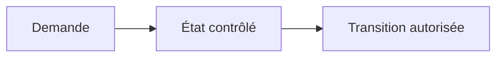
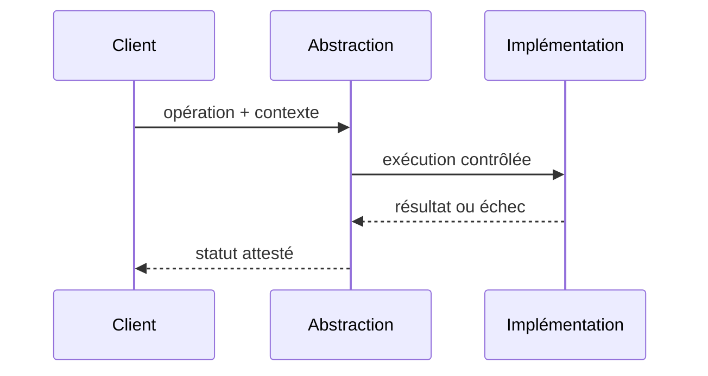

# State

## Problème

Éviter des conditions illisibles selon le cycle de vie d'un dossier.

## Diagramme de structure

## Exemple d'appel

## Invariant et preuve

- **Invariant :** Chaque transition est vérifiée par l'état courant et l'invariant métier.
- **Test négatif :** Passage SETTLED vers PROCESSING refusé sans mécanisme correctif.
- **Limite :** State GoF n'est pas Event Sourcing ni une saga persistante.
- Évaluer explicitement l'alternative simple, les coûts de maintenance, le comportement concurrent et les tests de contrat.

Ce pattern Java local ne dispense pas de politiques de sécurité ou de reprise d'un système distribué.

[Catalogue](../README.md)
