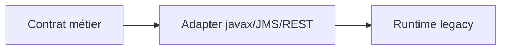
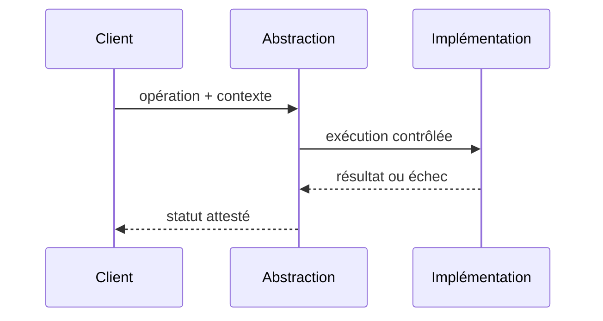

# Adapter

## Problème

Réutiliser une interface de moteur de règles ou d'application legacy à travers un contrat moderne.

## Diagramme de structure

## Exemple d'appel

## Invariant et preuve

- **Invariant :** Ne pas faire sortir un code erreur de l'éditeur comme décision métier sans traduction.
- **Test négatif :** Erreur legacy inconnue : résultat non confirmé, pas une approbation implicite.
- **Limite :** Adapter GoF est local; une ACL requiert aussi gouvernance sémantique et processus.
- Évaluer explicitement l'alternative simple, les coûts de maintenance, le comportement concurrent et les tests de contrat.

Ce pattern Java local ne dispense pas de politiques de sécurité ou de reprise d'un système distribué.

[Catalogue](../README.md)
