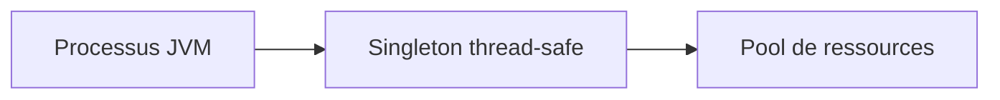
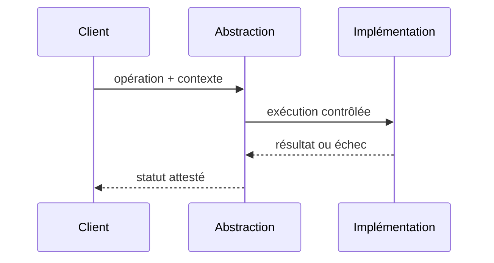

# Singleton — portée et dangers

## Problème

Un service veut partager une ressource coûteuse dans un seul processus.

## Diagramme de structure

## Exemple d'appel

## Invariant et preuve

- **Invariant :** Un singleton contrôle au plus un état par JVM, jamais une ressource unique entre réplicas Kubernetes.
- **Test négatif :** Tester concurrence, initialisation unique locale et comportement avec 2 processus séparés.
- **Limite :** Pour les pools JDBC utiliser gestion du conteneur et bornage global ; un singleton ne corrige pas une fuite de connexions.
- Évaluer explicitement l'alternative simple, les coûts de maintenance, le comportement concurrent et les tests de contrat.

Ce pattern Java local ne dispense pas de politiques de sécurité ou de reprise d'un système distribué.

[Catalogue](../README.md)
