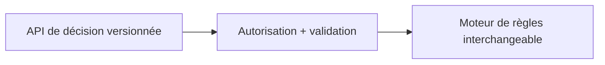
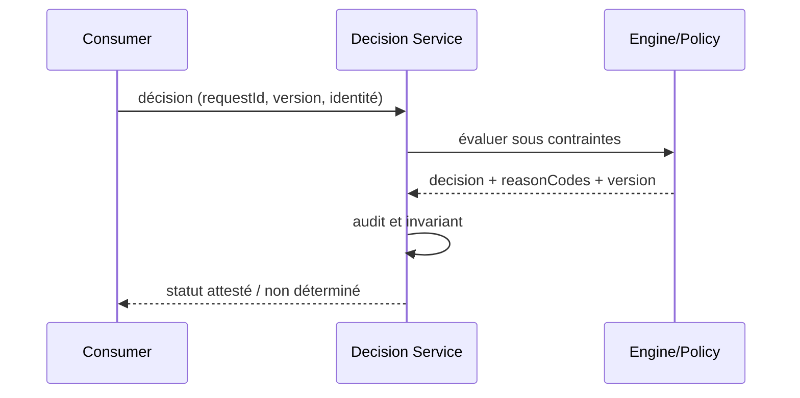

# Decision Service Boundary — Architecture décisionnelle

## Problème

Plusieurs consommateurs invoquent des décisions sans contrat stable. Pattern de référence indépendant d'un éditeur, sans affirmation d'exécution sous licence.

## Schéma logique

## Séquence de contrôle

## Invariant

Contrat de décision indépendant du fournisseur; une décision renseigne résultat, motifs, version et corrélation.

## Tests et gouvernance

1. Une version de moteur change : les cas métiers historiques gardent les mêmes contrats ou l'écart est expliqué.
2. Service indisponible : pas d'approbation implicite ; statuts indéterminés explicités.
3. Expirer le token ou demander un dossier d'un autre tenant : 401/403 sans exécution du moteur.
4. Tester incident pendant évaluation : aucune nouvelle écriture arbitraire; retour explicitement déterminé/inconnu.

## Alternatives et décision

Distinguer moteur éditeur, interpréteur libre, règles en code et décisions ML; comparer versions, coûts, licencing, débit et responsabilité de support. Un POC simulé ne prouve ni conformité des licences ODM ni compatibilité runtime éditeur. Documenter ADR, contrat et preuve d'exécution.

[Catalogue décisionnel](../README.md) · [Sécurité Zero Trust](../../14-security-zero-trust-patterns/README.md)
