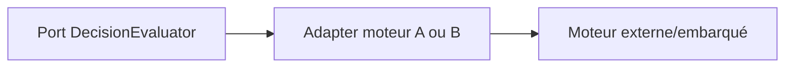
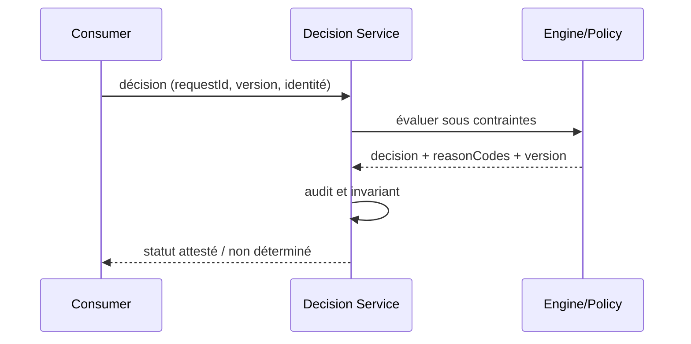

# Rule Engine Adapter — Architecture décisionnelle

## Problème

Remplacer une implémentation de moteur sans modifier les cas d'usage métier. Pattern de référence indépendant d'un éditeur, sans affirmation d'exécution sous licence.

## Schéma logique

## Séquence de contrôle

## Invariant

Seul l'adapter dépend de l'éditeur; le domaine ne connaît ni runtime, ni classes des règles.

## Tests et gouvernance

1. Une exception produit un refus ou état INDETERMINATE défini par politique, jamais succès silencieux.
2. Un jeu de 50 cas synthétiques traverse chaque adapter; aucune licence IBM implicite.
3. Expirer le token ou demander un dossier d'un autre tenant : 401/403 sans exécution du moteur.
4. Tester incident pendant évaluation : aucune nouvelle écriture arbitraire; retour explicitement déterminé/inconnu.

## Alternatives et décision

Distinguer moteur éditeur, interpréteur libre, règles en code et décisions ML; comparer versions, coûts, licencing, débit et responsabilité de support. Un POC simulé ne prouve ni conformité des licences ODM ni compatibilité runtime éditeur. Documenter ADR, contrat et preuve d'exécution.

[Catalogue décisionnel](../README.md) · [Sécurité Zero Trust](../../14-security-zero-trust-patterns/README.md)
