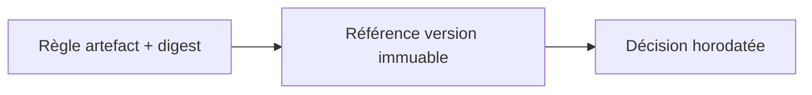
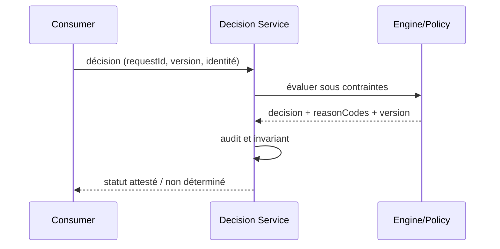

# Rule Version Pinning / Promotion — Architecture décisionnelle

## Problème

Deux environnements exécutent des versions divergentes de règles et rendent l'audit ambigu. Pattern de référence indépendant d'un éditeur, sans affirmation d'exécution sous licence.

## Schéma logique

## Séquence de contrôle

## Invariant

Chaque évaluation conserve ruleSetVersion et moteur + hash; déploiement signé et activation explicite.

## Tests et gouvernance

1. Pendant canary, la même requête avec version épinglée produit le même résultat déterministe.
2. Rollback des règles ne peut effacer les décisions historiques ni leur provenance.
3. Expirer le token ou demander un dossier d'un autre tenant : 401/403 sans exécution du moteur.
4. Tester incident pendant évaluation : aucune nouvelle écriture arbitraire; retour explicitement déterminé/inconnu.

## Alternatives et décision

Distinguer moteur éditeur, interpréteur libre, règles en code et décisions ML; comparer versions, coûts, licencing, débit et responsabilité de support. Un POC simulé ne prouve ni conformité des licences ODM ni compatibilité runtime éditeur. Documenter ADR, contrat et preuve d'exécution.

[Catalogue décisionnel](../README.md) · [Sécurité Zero Trust](../../14-security-zero-trust-patterns/README.md)
