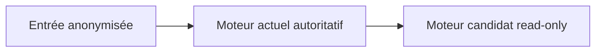
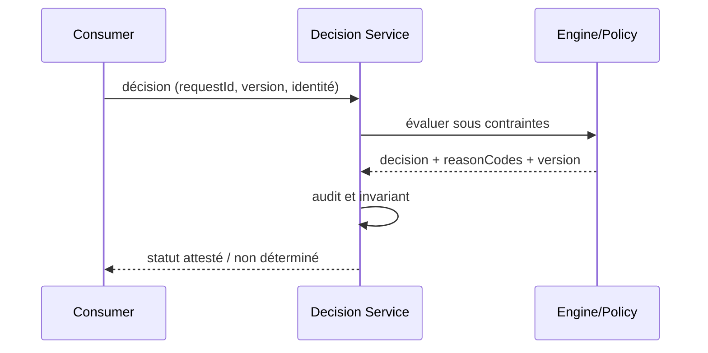

# Shadow Decision Evaluation — Architecture décisionnelle

## Problème

Une version candidate doit être évaluée sur les mêmes dossiers avant bascule. Pattern de référence indépendant d'un éditeur, sans affirmation d'exécution sous licence.

## Schéma logique

## Séquence de contrôle

## Invariant

Le moteur shadow ne doit produire aucun effet externe et ne fournit jamais la décision autoritative.

## Tests et gouvernance

1. Comparer décisions, motifs, délais et classes d'écarts sans utiliser de données personnelles réelles.
2. Si écarts inattendus dépassent un seuil approuvé : NO-GO et investigation.
3. Expirer le token ou demander un dossier d'un autre tenant : 401/403 sans exécution du moteur.
4. Tester incident pendant évaluation : aucune nouvelle écriture arbitraire; retour explicitement déterminé/inconnu.

## Alternatives et décision

Distinguer moteur éditeur, interpréteur libre, règles en code et décisions ML; comparer versions, coûts, licencing, débit et responsabilité de support. Un POC simulé ne prouve ni conformité des licences ODM ni compatibilité runtime éditeur. Documenter ADR, contrat et preuve d'exécution.

[Catalogue décisionnel](../README.md) · [Sécurité Zero Trust](../../14-security-zero-trust-patterns/README.md)
