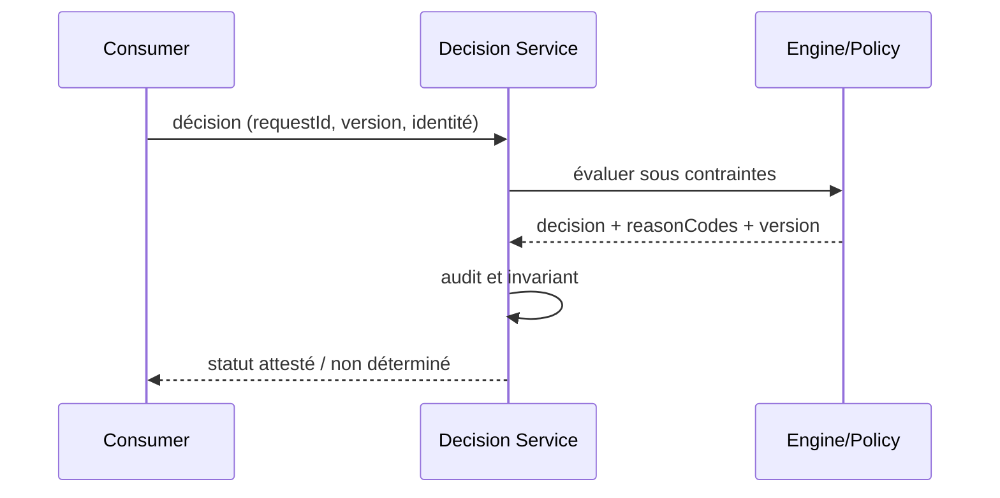

# Decision Audit & Human Review — Architecture décisionnelle

## Problème

Une décision sensible exige justification, provenance et éventuelle validation humaine. Pattern de référence indépendant d'un éditeur, sans affirmation d'exécution sous licence.

## Schéma logique

## Séquence de contrôle

## Invariant

Même identité et version de décision doivent être liées à l'approbation; l'IA peut conseiller mais jamais approuver seule.

## Tests et gouvernance

1. Réutiliser une approbation sur payload modifié : rejet.
2. Le journal protège les données sensibles et la séparation des rôles; rétention explicite.
3. Expirer le token ou demander un dossier d'un autre tenant : 401/403 sans exécution du moteur.
4. Tester incident pendant évaluation : aucune nouvelle écriture arbitraire; retour explicitement déterminé/inconnu.

## Alternatives et décision

Distinguer moteur éditeur, interpréteur libre, règles en code et décisions ML; comparer versions, coûts, licencing, débit et responsabilité de support. Un POC simulé ne prouve ni conformité des licences ODM ni compatibilité runtime éditeur. Documenter ADR, contrat et preuve d'exécution.

[Catalogue décisionnel](../README.md) · [Sécurité Zero Trust](../../14-security-zero-trust-patterns/README.md)
