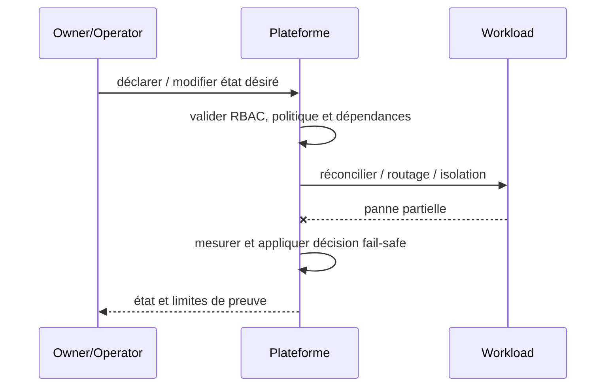

# Control Plane / Data Plane Separation — Platform Engineering

## Contexte et choix

Le plan de gouvernance et la requête métier ont des disponibilités et droits différents. Ce pattern est un **choix de frontière et de responsabilité** et non un nom de produit.

## Architecture

## Séquence de panne

## Invariant testable

Indisponibilité du control plane n'autorise pas une modification non validée du data plane.

## Qualification

- **Injection négative :** Échec GitOps/Operator : services métiers existants restent gouvernés selon politique; aucune mutation non autorisée.
- **Limite :** Séparer RBAC, identité runtime et SLO des deux plans.
- Définir compte/propriétaire, SLI/SLO et coût d'exploitation ; tester admission et comportement runtime séparément.
- Mesurer résultat sur Kind/CRC sans extrapoler au multi-site physique ni à la production.

## Alternatives

Cluster dédié, isolation par namespace, service managé ou contrôle manuel gouverné selon besoins et charge réels. Documenter coûts/licences et condition de rollback dans une ADR.

[Sommaire](../README.md) · [Patterns OpenShift](../../09-containerization-kubernetes-openshift-patterns/README.md)
