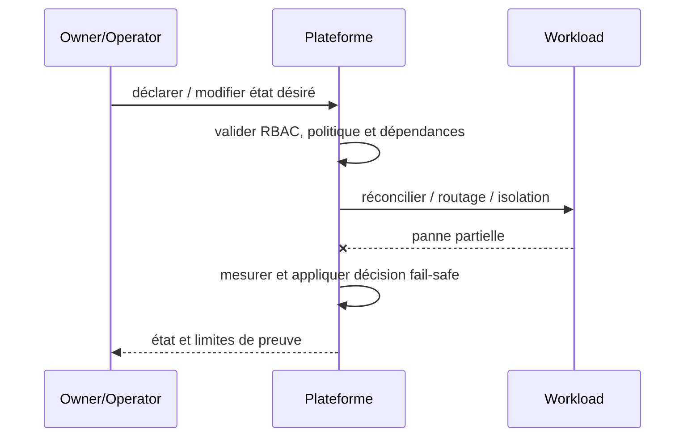

# Golden Path / Paved Road — Platform Engineering

## Contexte et choix

Chaque équipe recode sécurité, observabilité, pipeline et manifests différemment. Ce pattern est un **choix de frontière et de responsabilité** et non un nom de produit.

## Architecture

## Séquence de panne

## Invariant testable

Chemin standard donne non-root, probes, SBOM, secrets externalisés et restrictions par défaut.

## Qualification

- **Injection négative :** Image vulnérable/non signée : gate de promotion refuse.
- **Limite :** Dérogation possible par ADR datée, jamais contournement implicite.
- Définir compte/propriétaire, SLI/SLO et coût d'exploitation ; tester admission et comportement runtime séparément.
- Mesurer résultat sur Kind/CRC sans extrapoler au multi-site physique ni à la production.

## Alternatives

Cluster dédié, isolation par namespace, service managé ou contrôle manuel gouverné selon besoins et charge réels. Documenter coûts/licences et condition de rollback dans une ADR.

[Sommaire](../README.md) · [Patterns OpenShift](../../09-containerization-kubernetes-openshift-patterns/README.md)
