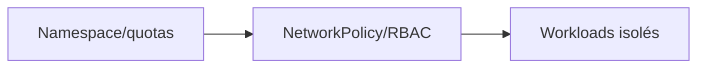
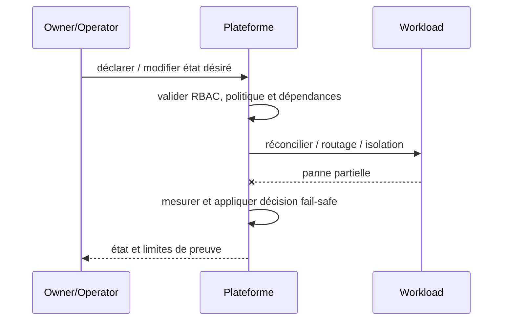

# Multi-Tenant Isolation / Noisy Neighbor — Platform Engineering

## Contexte et choix

Des équipes partagent un cluster et peuvent consommer les ressources ou données des autres. Ce pattern est un **choix de frontière et de responsabilité** et non un nom de produit.

## Architecture

## Séquence de panne

## Invariant testable

Tenant A ne peut lire secret de B ni ouvrir un flux est-ouest non autorisé.

## Qualification

- **Injection négative :** Tester token A vers service B, RBAC et ressources saturées.
- **Limite :** Le namespace seul n'est pas une garantie de sécurité ni de quota.
- Définir compte/propriétaire, SLI/SLO et coût d'exploitation ; tester admission et comportement runtime séparément.
- Mesurer résultat sur Kind/CRC sans extrapoler au multi-site physique ni à la production.

## Alternatives

Cluster dédié, isolation par namespace, service managé ou contrôle manuel gouverné selon besoins et charge réels. Documenter coûts/licences et condition de rollback dans une ADR.

[Sommaire](../README.md) · [Patterns OpenShift](../../09-containerization-kubernetes-openshift-patterns/README.md)
