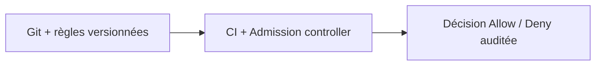
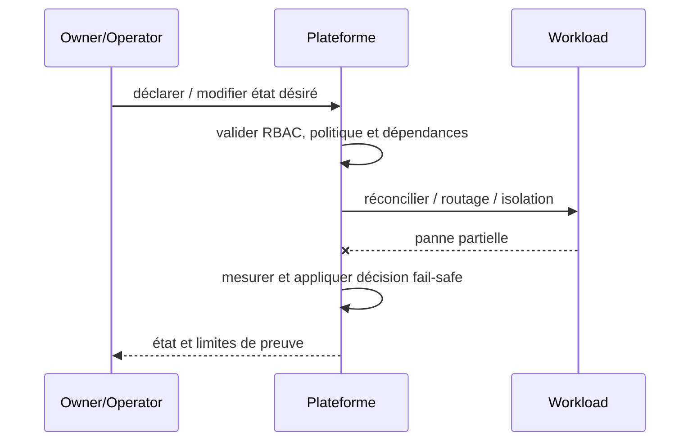

# Policy as Code / Admission Guardrails — Platform Engineering

## Contexte et choix

Des règles d'architecture sont écrites mais ne bloquent aucun déploiement risqué. Ce pattern est un **choix de frontière et de responsabilité** et non un nom de produit.

## Architecture

## Séquence de panne

## Invariant testable

La même politique et sa version sont évaluées en CI et sur admission quand techniquement possible.

## Qualification

- **Injection négative :** Pod privileged, latest tag et droits élevés doivent échouer selon profil applicable.
- **Limite :** Réduire faux positifs et documenter exception bornée; pas de mode permissif caché.
- Définir compte/propriétaire, SLI/SLO et coût d'exploitation ; tester admission et comportement runtime séparément.
- Mesurer résultat sur Kind/CRC sans extrapoler au multi-site physique ni à la production.

## Alternatives

Cluster dédié, isolation par namespace, service managé ou contrôle manuel gouverné selon besoins et charge réels. Documenter coûts/licences et condition de rollback dans une ADR.

[Sommaire](../README.md) · [Patterns OpenShift](../../09-containerization-kubernetes-openshift-patterns/README.md)
