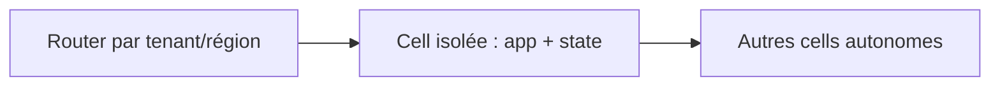
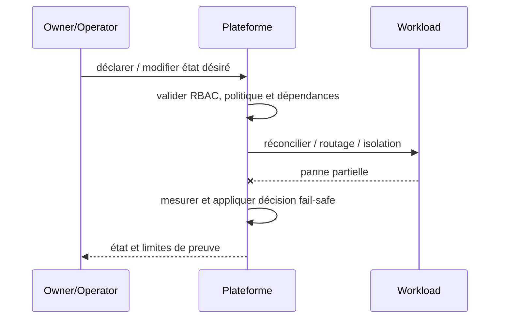

# Cell-Based Architecture / Fault Containment — Platform Engineering

## Contexte et choix

Une plateforme partagée possède un blast radius trop grand. Ce pattern est un **choix de frontière et de responsabilité** et non un nom de produit.

## Architecture

## Séquence de panne

## Invariant testable

La panne d'une cell n'affecte pas les transactions d'une autre; ownership et données restent définis.

## Qualification

- **Injection négative :** Injecter perte de cell A : B répond, aucune double écriture de A.
- **Limite :** L'isolation coûte plus cher : réserver aux domaines exigeant ce niveau de continuité.
- Définir compte/propriétaire, SLI/SLO et coût d'exploitation ; tester admission et comportement runtime séparément.
- Mesurer résultat sur Kind/CRC sans extrapoler au multi-site physique ni à la production.

## Alternatives

Cluster dédié, isolation par namespace, service managé ou contrôle manuel gouverné selon besoins et charge réels. Documenter coûts/licences et condition de rollback dans une ADR.

[Sommaire](../README.md) · [Patterns OpenShift](../../09-containerization-kubernetes-openshift-patterns/README.md)
