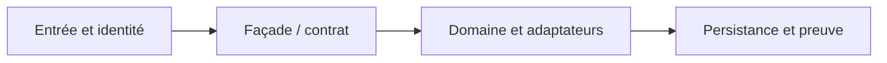

# Java/JEE : migration progressive vers OpenShift

**Cas d'architecture original et synthétique pour préparer des missions futures.** Pas un état client réellement déployé.

## 1. Décision à instruire

Un domaine legacy a des WAR/EAR, des ressources JDBC/JMS/JTA et des traitements par lots. Il doit passer à Liberty/OpenShift sans présumer que ses EJB, transactions XA, SSO et librairies éditeur sont compatibles.

## 2. Architecture de principe

Flux métier envisagé : **Canal API --> Façade de routage --> Application traditionnelle / Service Liberty --> DB et MQ autoritatifs**. Chaque flèche doit porter un propriétaire, un contrat, une politique de sécurité et un comportement en timeout.

## 3. Patterns sélectionnés

- [10 enterprise architecture patterns](../../10-enterprise-architecture-patterns/04-application-landscape/README.md)
- [17 legacy modernization patterns](../../17-legacy-modernization-patterns/07-strangler-fig-migration/README.md)
- [17 legacy modernization patterns](../../17-legacy-modernization-patterns/08-parallel-run-shadow/README.md)
- [11 application software patterns](../../11-application-software-patterns/15-branch-by-abstraction/README.md)
- [16 performance sre patterns](../../16-performance-sre-patterns/04-connection-pooling/README.md)
- [09 containerization kubernetes openshift patterns](../09-containerization-kubernetes-openshift-patterns/README.md)

## 4. Exécution de la démarche

1. **AS-IS et ownership** : Cartographier dépendances réelles, contrats de session, pool global et ownership des données avant toute bascule.
2. **Architecture de transition** : Déployer une façade routant une capacité de lecture vers Liberty, conserver l'écriture sur un seul système maître.
3. **Critère de validation** : Exécuter shadow en lecture seule; comparer équivalence métier, latence p99 et écarts.
4. **Failure engineering** : Test d'arrêt de Pod / panne DB / expiration token / exception MQ / redélivrance.
5. **Décision et limites** : Rollback exige compatibilité des schémas et conservation des écritures ; reporter si preuve éditeur ou licence manquante.

## 5. Livrables d'architecture demandés

- Contexte, hypothèses, diagramme d'interactions, contrats versionnés et NFR non inventés.
- ADR avec minimum deux options comparées : statu quo, progression ciblée et refonte si pertinente.
- Matrice de tests : nominal, duplicata, réponse perdue, panne partielle, droits objet et retour arrière.
- Verdict `GO`, `GO_CONDITIONNEL` ou `NO_GO` selon preuves, licences, sécurité et coûts.
- Rapport de test horodaté avec commande, environnement et limite de preuve; une fiche de conception n'est pas une preuve runtime.

[Recueil des cas transversaux](../README.md)
