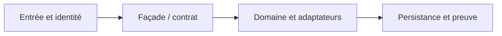

# Plateforme décisionnelle : moteurs interchangeables et sécurité

**Cas d'architecture original et synthétique pour préparer des missions futures.** Pas un état client réellement déployé.

## 1. Décision à instruire

Un service métier doit pouvoir changer de moteur de règles, comparer une version candidate et tracer les raisons d'une décision, sans doubler les effets de bord.

## 2. Architecture de principe

Flux métier envisagé : **Canal autorisé --> Decision API --> Adapter moteur A | Moteur shadow B --> Audit versionné**. Chaque flèche doit porter un propriétaire, un contrat, une politique de sécurité et un comportement en timeout.

## 3. Patterns sélectionnés

- [20 decision management patterns](../../20-decision-management-patterns/01-decision-service-boundary/README.md)
- [20 decision management patterns](../../20-decision-management-patterns/02-rule-engine-adapter/README.md)
- [20 decision management patterns](../../20-decision-management-patterns/03-rule-version-pinning/README.md)
- [20 decision management patterns](../../20-decision-management-patterns/04-shadow-decision-evaluation/README.md)
- [20 decision management patterns](../../20-decision-management-patterns/05-decision-audit-human-review/README.md)
- [14 security zero trust patterns](../../14-security-zero-trust-patterns/02-policy-decision-enforcement/README.md)

## 4. Exécution de la démarche

1. **AS-IS et ownership** : Épingler le jeu de règles et calculer une empreinte, inclure motifs, date et identifiant de requête.
2. **Architecture de transition** : Distinguer moteur principal autoritatif et moteur candidat read-only; aucun effet externe du shadow.
3. **Critère de validation** : Comparer jeux de décisions Golden Master; classifier divergences attendues et inattendues.
4. **Failure engineering** : Forcer rôle invalide, payload changé, décision non déterminée, régression et token expiré.
5. **Décision et limites** : No-Go en cas de différence non expliquée, de risque licence ou d'absence de rollback.

## 5. Livrables d'architecture demandés

- Contexte, hypothèses, diagramme d'interactions, contrats versionnés et NFR non inventés.
- ADR avec minimum deux options comparées : statu quo, progression ciblée et refonte si pertinente.
- Matrice de tests : nominal, duplicata, réponse perdue, panne partielle, droits objet et retour arrière.
- Verdict `GO`, `GO_CONDITIONNEL` ou `NO_GO` selon preuves, licences, sécurité et coûts.
- Rapport de test horodaté avec commande, environnement et limite de preuve; une fiche de conception n'est pas une preuve runtime.

[Recueil des cas transversaux](../README.md)
